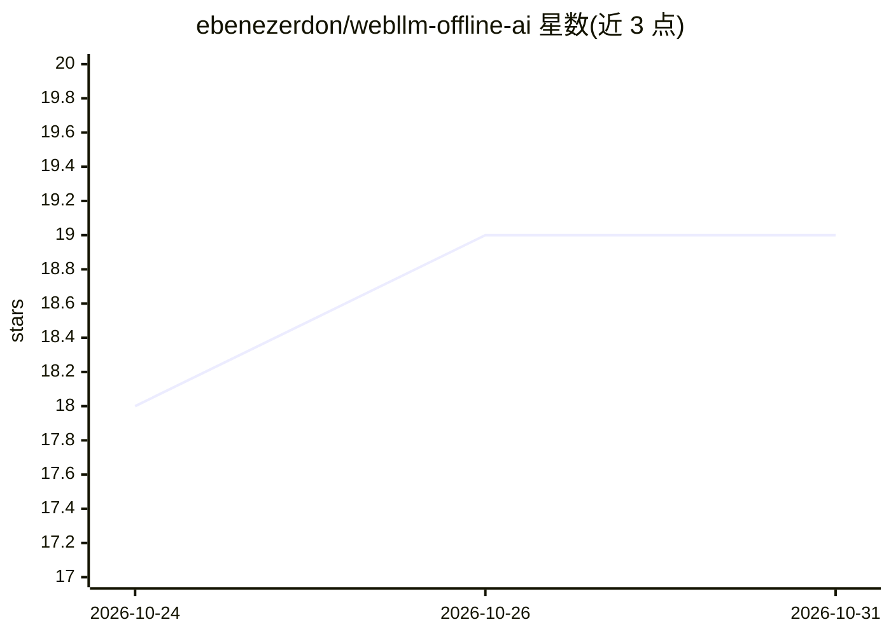

# ebenezerdon/webllm-offline-ai

⭐ 19 · JavaScript · GPL-3.0 · 推送 2026-10-23 · [GitHub](https://github.com/ebenezerdon/webllm-offline-ai) · [官网](https://chat.ebenezerdon.com) · 个人维护

**浏览器内本地运行 LLM 的聊天应用，PC 桌面风格界面**

基于 WebGPU 与 WebLLM 的浏览器端聊天应用：模型权重下载后在本地浏览器中推理，无需服务器。界面模拟 PC 桌面环境，含任务栏、可拖拽窗口与窗口控制。提供多种尺寸模型选择、下载进度条与模型信息（下载体积、VRAM 需求、参数量）；模型缓存于 IndexedDB，后续加载无需重新下载。要求 Chrome/Edge 113+ 或 Firefox 118+ 且启用 WebGPU，大模型需 10GB+ VRAM。本地运行仅需克隆仓库并打开 index.html。

## 筛选速览

| 维度 | 判定 | 备注 |
|---|---|---|
| AI 角色 | `ai-native` | 本体是模型或模型工具 |
| 许可风险 | `viral` | GPL-3.0 |
| 部署形态 | `None` |  |
| 模型依赖 | — | README 未给出锁定关系 |
| 硬件要求 | — | 无带数字的原话,不猜 |
| 安装摩擦 | `low` | 无编译、无系统依赖或容器化 |
| 成熟度 | — | 结构信号不足 |

## 能力要点

- 模型在浏览器本地推理，无需服务器
- 模拟 PC 桌面环境（任务栏、可拖拽窗口）
- 模型选择与下载进度跟踪、VRAM 需求展示
- 模型权重缓存于 IndexedDB

## 适用场景

- 在浏览器中体验本地运行的 LLM 聊天
- 无服务器环境下进行模型推理对话
- 对比不同尺寸模型的浏览器端运行情况

## 场景标签

`聊天机器人` · 领域:对话与助手

## 证据(README 行号)

> L3: This is a browser-based LLM chat application that runs AI models directly in your browser using WebGPU technology, p
> L13: - 🤖 **Run large language models** directly in your browser.

## 星数曲线

2026-10-24 18 → 2026-10-31 19（+1）

---
*卡片 v1 · prompt 1.4 · 生成 2026-10-28 · 置信度 high · 依据 README sha `04018c2bc933` · [字段定义](../../DATASET.md)*
