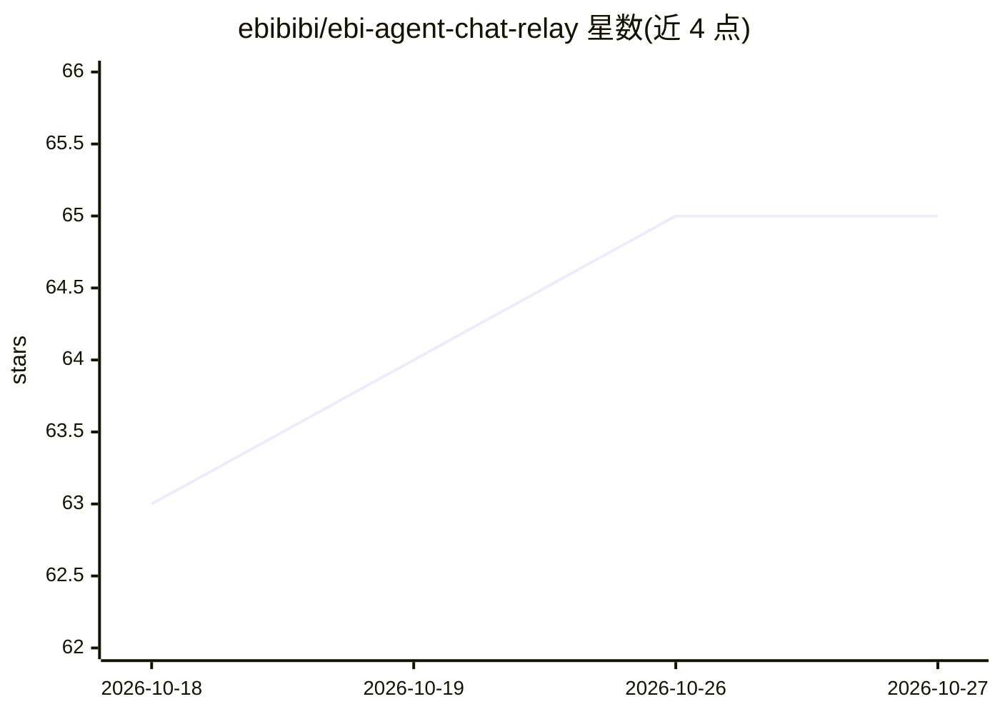

# ebibibi/ebi-agent-chat-relay

⭐ 65 · Python · MIT · 推送 2026-10-26 · [GitHub](https://github.com/ebibibi/ebi-agent-chat-relay) · 个人维护 · 中文 README

**多前端统一驾驶舱：并行运行与监督多个编码 agent CLI**

一个中继进程同时驱动 Claude Code、OpenAI Codex、本地模型（Ollama 等）、pi 与 AG-UI agent，以官方 CLI 子进程方式运行、不接触 API key。前端可选自有 Web 控制台（支持 passkeys/Entra ID/OIDC 登录）、Discord 或 Microsoft Teams。支持管理 agent 委派子 agent、按会话 git worktree 隔离、资源认领与协调通道，另含调度器、REST API 与沙箱执行环境。需 Python 3.12+ 与 uv，从源码运行。

## 筛选速览

| 维度 | 判定 | 备注 |
|---|---|---|
| AI 角色 | `ai-ecosystem` | LLM/agent 周边工具 |
| 许可风险 | `permissive` | MIT |
| 部署形态 | `None` |  |
| 模型依赖 | local-ok | 支持本地模型 |
| 硬件要求 | — | 无带数字的原话,不猜 |
| 安装摩擦 | `low` | 无编译、无系统依赖或容器化 |
| 成熟度 | — | 结构信号不足 |

## 能力要点

- 以子进程驱动官方 agent CLI，会话间切换后端不丢失对话
- 管理/子 agent 分层委派，管理器用强模型、子任务用便宜或本地模型
- 每会话独立 git worktree，配合会话注册表、AI Lounge 与资源认领避免并行冲突
- Web 控制台默认强制认证：passkeys（WebAuthn）及可选 Entra ID/Google/OIDC

## 适用场景

- 在统一界面里同时监督多个并行编码 agent 的进展并决定下一步
- 通过 Discord 或 Teams 在团队现有沟通渠道中指挥编码 agent
- 让强模型做规划、把具体任务委派给便宜或本地模型以控制成本

## 场景标签

`多智能体` `编码 Agent` · 领域:Agent 开发

## 证据(README 行号)

> L9: **One cockpit for all your coding agents.** Run Claude Code, OpenAI Codex, local models, pi and
> L93: The relay drives the **official CLIs** as subprocesses, so every agent keeps its own tools, skills,
> L159: sessions from scripts and CI, and **execution environments** (bubblewrap, containers, SSH) that put

## 星数曲线

2026-10-18 63 → 2026-10-27 65（+2）

---
*卡片 v1 · prompt 1.4 · 生成 2026-10-24 · 置信度 high · 依据 README sha `6cecf2ae6f9d` · [字段定义](../../DATASET.md)*
