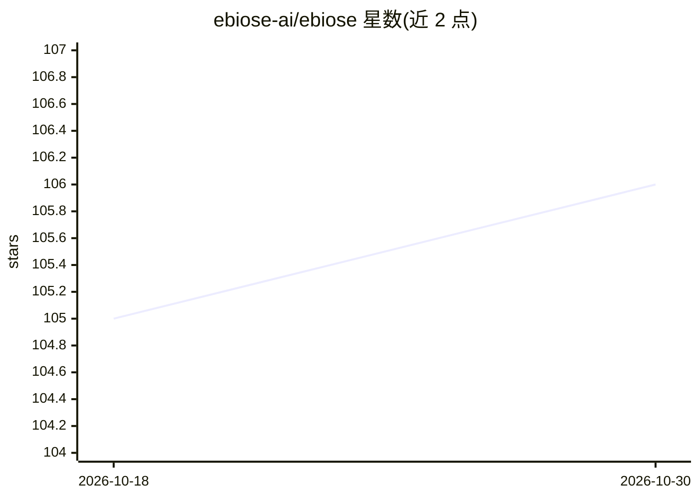

# ebiose-ai/ebiose

⭐ 106 · NOASSERTION · 推送 2026-10-22 · [GitHub](https://github.com/ebiose-ai/ebiose) · [官网](https://www.ebiose.com/) · 组织维护

**创建与进化 AI agent 的开源框架（Inria 孵化）**

Inria（法国国家研究机构，scikit-learn 出品方）孵化公司 Ebiose AI 的开源项目，定位为分布式 AI 工厂：用户定义任务与成功度量，框架负责构建、评估并迭代改进适配该任务的 agent。新版本引入 Genomic Engine，除改进 agent 外还改进 agent 的创建方式；新框架代码尚未公开，计划 2026 年 11 月以 MIT 许可发布。当前仅 beta-0.1 标签代码可用（git clone 获取），issues 与 PR 已关闭，待新版重启。

## 筛选速览

| 维度 | 判定 | 备注 |
|---|---|---|
| AI 角色 | `ai-ecosystem` | LLM/agent 周边工具 |
| 许可风险 | `none` | NOASSERTION |
| 部署形态 | `None` |  |
| 模型依赖 | — | README 未给出锁定关系 |
| 硬件要求 | — | 无带数字的原话,不猜 |
| 安装摩擦 | `low` | 无编译、无系统依赖或容器化 |
| 成熟度 | `idea` | |

## 能力要点

- 用户定义任务与度量，框架自动构建/评估/改进 agent
- Genomic Engine：同时改进 agent 本体与创建流程
- 新版计划 2026 年 11 月以 MIT 许可开源
- beta-0.1 标签代码可 git clone 获取

## 适用场景

- 为特定任务自动构建并持续优化的 agent
- 研究 agent 的进化式生成与评估方法
- 跟踪即将发布的自进化 AI 工厂框架

## 场景标签

`Agent 框架` `模型评测` · 领域:Agent 开发

## 证据(README 行号)

> L18: scikit-learn) spin-off building an open-source framework for creating and evolving AI
> L19: agents. You define a task and how to measure success. Ebiose builds, evaluates, and improves
> L25: The new framework is in active development. Its code is not public yet. It will launch here

## 星数曲线

2026-10-18 105 → 2026-10-30 106（+1）

---
*卡片 v1 · prompt 1.4 · 生成 2026-10-23 · 置信度 mid · 依据 README sha `f9133e493a1f` · [字段定义](../../DATASET.md)*
