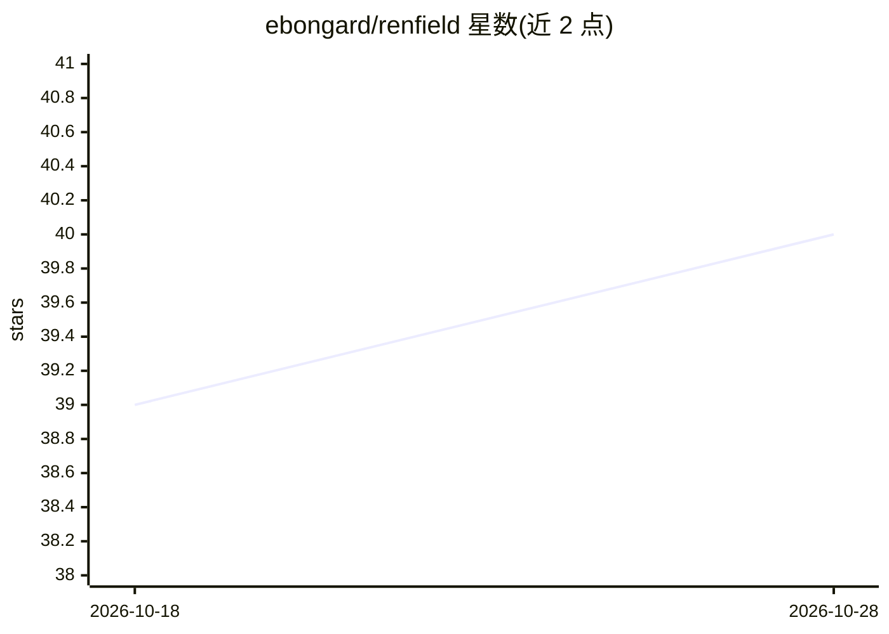

# ebongard/renfield

⭐ 40 · Python · MIT · 推送 2026-10-27 · [GitHub](https://github.com/ebongard/renfield) · 个人维护

**自托管离线语音 AI 助手，支持多房间语音卫星与 RAG 知识库**

基于 FastAPI + React + Ollama 的自托管个人 AI 助手：提供聊天界面（流式响应）、ReAct Agent 系统（10 个 MCP 服务器、100+ 工具）、混合检索 RAG 知识库（pgvector 稠密向量 + BM25，RRF 融合）、知识图谱、长期记忆与意图反馈学习。语音链路含 Whisper STT、Piper TTS、说话人识别，通过树莓派 Zero 2 W + ReSpeaker HAT（约 58 美元/房间）构建多房间语音卫星，支持 BLE/语音/Web 认证的存在检测。可完全离线运行，LLM 层走 OpenAI 兼容协议可路由到 llama.cpp 等后端；通过 Docker Compose 部署。

## 筛选速览

| 维度 | 判定 | 备注 |
|---|---|---|
| AI 角色 | `ai-native` | 本体是模型或模型工具 |
| 许可风险 | `permissive` | MIT |
| 部署形态 | `self-host` | docker 或自建部署 |
| 模型依赖 | local-ok | 支持本地模型 |
| 硬件要求 | — | 无带数字的原话,不猜 |
| 安装摩擦 | `low` | 无编译、无系统依赖或容器化 |
| 成熟度 | — | 结构信号不足 |

## 能力要点

- 10 个 MCP 服务器、100+ 工具的 ReAct Agent 多步工具链
- pgvector + BM25 混合检索 RAG，支持 PDF/DOCX/HTML 等格式与 OCR
- 树莓派语音卫星实现本地唤醒词、STT/TTS 全离线语音
- 多源存在检测与房间级隐私感知 TTS

## 适用场景

- 在自有硬件上搭建完全离线、数据不出内网的 AI 助手
- 用树莓派卫星实现全屋语音交互与多房间音频路由
- 结合 Home Assistant、n8n、Paperless 做智能家居与文档自动化

## 场景标签

`AI 助手` `语音 Agent` `RAG` · 领域:对话与助手

## 证据(README 行号)

> L5: **Self-hosted AI assistant with voice satellites, 100+ tool integrations, and full offline capability.**
> L46: - **Chat interface** with streaming responses, conversation history, inline album art, collapsible agent steps
> L51: - **Voice I/O** — Whisper STT + Piper TTS + SpeechBrain speaker recognition

## 星数曲线

2026-10-18 39 → 2026-10-28 40（+1）

---
*卡片 v1 · prompt 1.4 · 生成 2026-10-25 · 置信度 high · 依据 README sha `6b6cabc3853d` · [字段定义](../../DATASET.md)*
