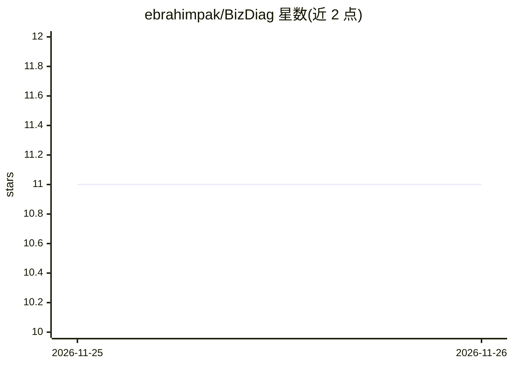

# ebrahimpak/BizDiag

⭐ 11 · JavaScript · NOASSERTION · 推送 2026-11-25 · [GitHub](https://github.com/ebrahimpak/BizDiag) · 个人维护

**面向企业架构师的 ArchiMate 模型分析与 AI 辅助文档套件**

基于 jArchi/Archi 的模块化套件，将 ArchiMate 企业架构模型转换为可查询、可转换、可用 AI 富化的结构化数据。模块包括业务-IT 对齐分析（五阶段评估、误对齐症状目录、严重度分级、CSV/Excel 导出）、基于能力的规划、商业模型画布、UML 子系统、客户机/服务器数据集成（H2 数据库、REST/TCP、JSONL 导出）。强调 human-in-the-loop：自动检测结果作为分析指标，由架构师判断实际意义。以开源核心形式提供，另有面向行业的商业上层产品。

## 筛选速览

| 维度 | 判定 | 备注 |
|---|---|---|
| AI 角色 | `ai-enhanced` | 去掉 AI 部分产品仍成立 |
| 许可风险 | `none` | NOASSERTION |
| 部署形态 | `None` |  |
| 模型依赖 | — | README 未给出锁定关系 |
| 硬件要求 | — | 无带数字的原话,不猜 |
| 安装摩擦 | `low` | 无编译、无系统依赖或容器化 |
| 成熟度 | — | 结构信号不足 |

## 能力要点

- 业务-IT 对齐五阶段评估：症状目录、严重度分级、CSV/Excel 报告导出
- 架构模型数据化：可加载 H2 关系数据库并用 SQL 查询（GUI 与 Web 控制台）
- GraalJS 客户机/服务器模板与 REST/TCP 数据集成组件
- AI 辅助架构文档与模型数据 AI 富化

## 适用场景

- 系统性排查企业架构模型中的业务-IT 误对齐症状
- 把 ArchiMate 模型当作结构化数据做依赖分析与自定义 SQL 查询
- 生成商业模型画布与 EA 架构蓝图文档
- 为架构模型搭建客户机/服务器数据管道

## 场景标签

 · 领域:企业架构/数字战略工具

## 证据(README 行号)

> L7: BizDiag™ is an open-source software suite that transforms ArchiMate® models into structured, analyzable data to supp
> L9: Intelligent EA Architecture Blueprint, Capability-Based Planning, and AI-assisted architecture documentation. BizDia
> L21: develop reusable automation around Enterprise Architecture models. Built around ArchiMate®, Archi, jArchi, GraalVM®

## 星数曲线

2026-11-25 11 → 2026-11-26 11（+0）

---
*卡片 v1 · prompt 1.4 · 生成 2026-11-24 · 置信度 mid · 依据 README sha `b15c90c3c2fc` · [字段定义](../../DATASET.md)*
