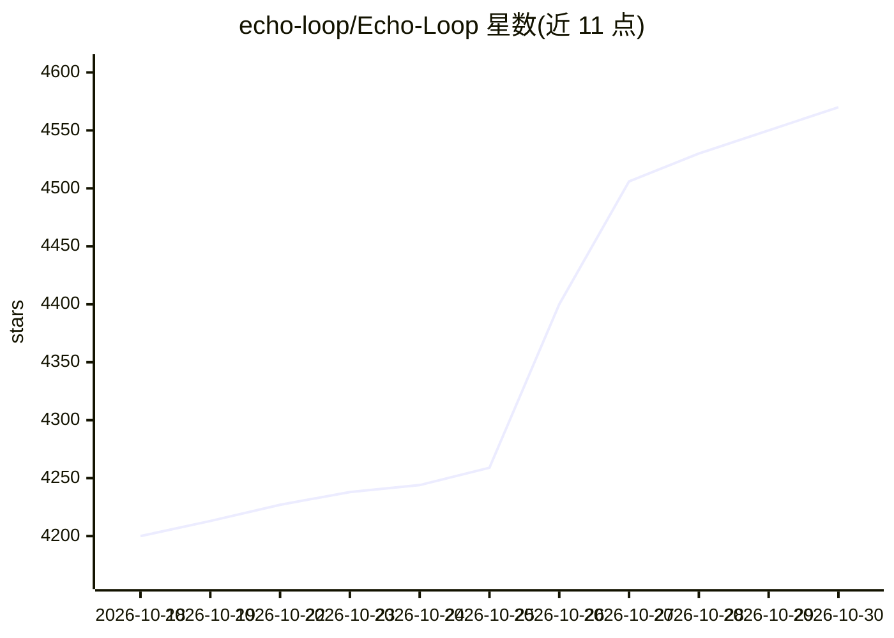

# echo-loop/Echo-Loop

⭐ 4,570 · Dart · AGPL-3.0 · 推送 2026-10-28 · [GitHub](https://github.com/echo-loop/Echo-Loop) · [官网](https://www.echo-loop.top) · 组织维护 · 中文 README

**自动驱动听说闭环的英语学习 App（Flutter）**

面向英语学习者的移动端听说训练应用：将精听、跟读、盲听、复述与间隔复习（6 小时至 28 天共 7 轮）串成自动推进的学习闭环，包含长难句意群划分、难句收藏、语境化闪卡、断点续学与学习数据统计。AI 功能包括翻译、句子解析、词汇讲解、跟读评测与 AI 字幕转录。基于 Flutter 开发，提供 App Store、Google Play 与 Android APK 下载；macOS 桌面端开发中，Windows 规划中。方法论由中央民族大学外国语学院教师指导设计。

## 筛选速览

| 维度 | 判定 | 备注 |
|---|---|---|
| AI 角色 | `ai-enhanced` | 去掉 AI 部分产品仍成立 |
| 许可风险 | `viral` | AGPL-3.0 |
| 部署形态 | `None` |  |
| 模型依赖 | — | README 未给出锁定关系 |
| 硬件要求 | — | 无带数字的原话,不猜 |
| 安装摩擦 | `low` | 无编译、无系统依赖或容器化 |
| 成熟度 | — | 结构信号不足 |

## 能力要点

- 精听→跟读→盲听→复述→间隔复习（6h–28d 七轮）自动驱动闭环
- AI 翻译、句子解析、词汇讲解与跟读 AI 评测
- 长难句意群划分与难句收藏专项复习
- 本地音频批量导入，可 AI 自动转录生成字幕

## 适用场景

- 按系统安排的节奏把一段英语音频从听懂练到会说
- 用间隔复习巩固难句、生词与收藏内容
- 碎片时间断点续学，查看学习时长与输入输出比等数据

## 场景标签

 · 领域:教育/语言学习

## 证据(README 行号)

> L36: 说得直白一点，Echo Loop 是一款科学高效的英语听说训练 App。它帮助你把一段音频从陌生练到真正听懂，再通过跟读和复述实现听说闭环，逐步练到脱口而出。系统会自动安排间隔复习和提醒，逐步推进训练节奏。你不用自己摸索方法，也不
> L59: - 💡 **AI 翻译、解析与词汇讲解**：支持双语翻译、句子解析、单词用法和搭配讲解，按需展开，不打断学习节奏。
> L62: - 🎙️ **跟读 AI 评测**：自动对齐识别结果与原文，高亮命中词，并给出跟读评级。

## 星数曲线

2026-10-18 4,200 → 2026-10-30 4,570（+370）

---
*卡片 v1 · prompt 1.4 · 生成 2026-10-21 · 置信度 high · 依据 README sha `61f642f0c088` · [字段定义](../../DATASET.md)*
