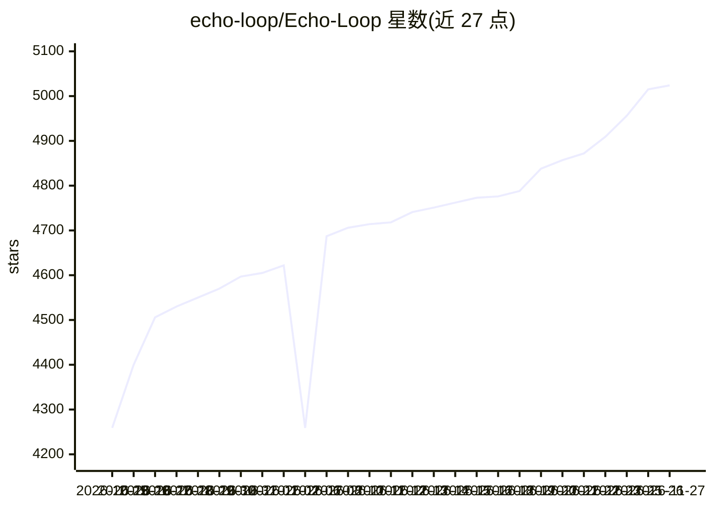

# echo-loop/Echo-Loop

⭐ 5,024 · Dart · AGPL-3.0 · 推送 2026-11-20 · [GitHub](https://github.com/echo-loop/Echo-Loop) · [官网](https://www.echo-loop.top) · 组织维护 · 中文 README

**给英语学习者的精听训练 App：自动驱动听说闭环与间隔复习**

基于 Flutter 的开源英语精听应用，覆盖 iOS/Android（桌面端开发中）。核心是把精听、跟读、盲听、复述、间隔复习（1 次首学 + 7 轮复习，间隔 6 小时至 14 天）串成自动推进的训练流程。支持导入本地音视频与字幕、AI 转录生成字幕、AI 翻译与句子/词汇讲解、基于离线语音识别的跟读评测、难句收藏、闪卡复习、学习数据统计与 PDF 导出。基础功能免费不限量，AI 讲解类功能按月度额度计费，会员用于覆盖大模型调用开销。

## 筛选速览

| 维度 | 判定 | 备注 |
|---|---|---|
| AI 角色 | `ai-enhanced` | 去掉 AI 部分产品仍成立 |
| 许可风险 | `viral` | AGPL-3.0 |
| 部署形态 | `None` |  |
| 模型依赖 | — | README 未给出锁定关系 |
| 硬件要求 | — | 无带数字的原话,不猜 |
| 安装摩擦 | `medium` | 含编译或系统依赖之一 |
| 成熟度 | — | 结构信号不足 |

## 能力要点

- 精听→跟读→盲听→复述→间隔复习的自动驱动闭环（6h→14d，7 轮约 28 天）
- sherpa_onnx 本机离线语音识别做跟读评测与本地字幕转录
- AI 翻译/句子解析/词汇讲解/AI 学习助手，按月度额度计费
- 支持本地音视频批量导入、字幕编辑剪辑、断点续学与 PDF 导出

## 适用场景

- 用播客、TED、美剧片段做逐句精听与跟读练习
- 按艾宾浩斯节奏自动安排复习，不手动管理复习计划
- 给没有字幕的音频自动转录生成字幕
- 离线练习听说，跟踪学习时长与词汇量数据

## 场景标签

`语音识别` · 领域:感知与多模态

## 证据(README 行号)

> L36: 说得直白一点，Echo Loop 是最专业的英语精听 App，也是一款科学高效的英语听说训练 App。它帮助你把一段音频从陌生练到真正听懂，再通过跟读和复述实现听说闭环，逐步练到脱口而出。系统会自动安排间隔复习和提醒，逐步推进训练
> L63: - 🎧 **导入本地音视频 + AI 字幕**：支持批量导入本地音频和视频，可导入本地字幕，也可用 AI 自动转录生成字幕。
> L341: |离线语音识别|sherpa_onnx|本机转录与跟读识别|

## 星数曲线

2026-10-25 4,259 → 2026-11-27 5,024（+765）

---
*卡片 v1 · prompt 1.4 · 生成 2026-11-22 · 置信度 high · 依据 README sha `c3842545006f` · [字段定义](../../DATASET.md)*
