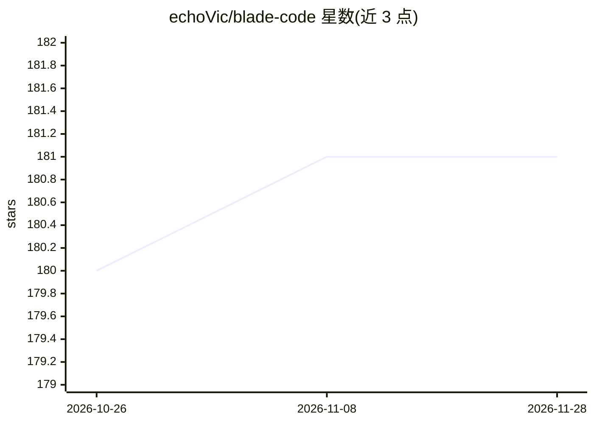

# echoVic/blade-code

⭐ 181 · TypeScript · MIT · 推送 2026-11-16 · [GitHub](https://github.com/echoVic/blade-code) · [官网](https://echovic.github.io/blade-code/) · 个人维护 · 中文 README

**终端/浏览器/无头三模式的 CLI 编程 Agent，多模型接入**

Blade Code 是开源 AI 编程助手，提供交互式 CLI、Web UI 与供脚本/CI 使用的 Headless JSONL 三种运行模式。基于 pi-ai 统一接入 38+ 模型 Provider，内置 20+ 工具（文件编辑、代码搜索、Shell、Git、浏览器自动化），支持 MCP、插件、Skills、Hooks 扩展，带跨会话自动记忆、四级权限模式与 token/费用统计。需 Node.js ≥ 22.19.0，通过 npx 或源码运行。

## 筛选速览

| 维度 | 判定 | 备注 |
|---|---|---|
| AI 角色 | `ai-native` | 本体是模型或模型工具 |
| 许可风险 | `permissive` | MIT |
| 部署形态 | `library` | 以包/库形式分发 |
| 模型依赖 | — | README 未给出锁定关系 |
| 硬件要求 | — | 无带数字的原话,不猜 |
| 安装摩擦 | `low` | 无编译、无系统依赖或容器化 |
| 成熟度 | — | 结构信号不足 |

## 能力要点

- CLI / Web UI / Headless JSONL 三种运行模式，另有 --acp 供 ACP 客户端调用
- 通过 pi-ai 统一接入 38+ 模型 Provider，模型元数据自动获取
- 20+ 内置工具与原生浏览器自动化（隔离 Chromium、ARIA 快照）
- 四级权限模式加工具白/黑名单，会话级 token 与费用统计

## 适用场景

- 在终端里用自然语言让 AI 完成代码编辑、搜索与 Git 操作
- 在 CI 或脚本中以 Headless JSONL 方式运行 agent 任务
- 配置自己的 API Key 接入 DeepSeek、OpenAI、Anthropic 等模型
- 通过 MCP、Skills、Hooks 扩展编程助手能力

## 场景标签

`编码 Agent` `浏览器自动化` · 领域:效率与自动化

## 证据(README 行号)

> L12: Blade Code 是一个开源的 AI 编程助手：终端里的交互式 CLI、浏览器里的 Web UI，以及给脚本和 CI 用的 Headless JSONL。基于 pi-ai 统一 38+ 模型 Provider，内置工具、浏览器
> L24: - 🤖 **多模型**：通过 pi-ai 统一 OpenAI、Anthropic、DeepSeek、Google、Bedrock 等 38+ Provider，模型元数据动态获取。
> L25: - 🌐 **三种运行模式**：CLI / Web UI / Headless JSONL，另有 `blade --acp` 供 Pilion 这类 ACP 客户端调用。

## 星数曲线

2026-10-26 180 → 2026-11-28 181（+1）

---
*卡片 v1 · prompt 1.4 · 生成 2026-11-26 · 置信度 high · 依据 README sha `f36e60ec2a53` · [字段定义](../../DATASET.md)*
