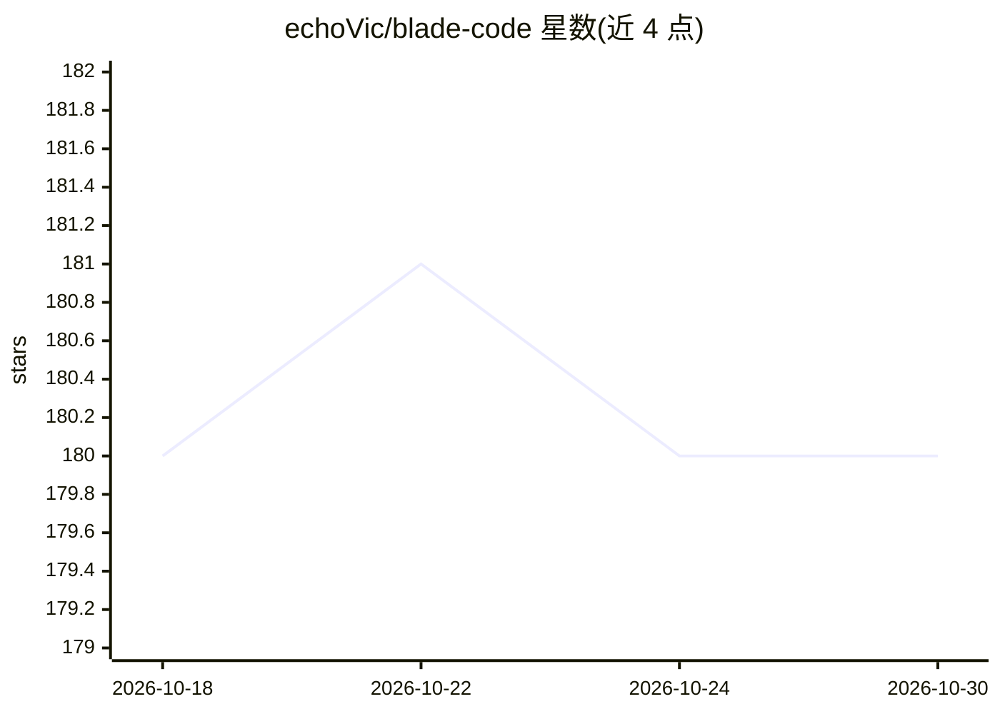

# echoVic/blade-code

⭐ 180 · TypeScript · MIT · 推送 2026-10-13 · [GitHub](https://github.com/echoVic/blade-code) · [官网](https://echovic.github.io/blade-code/) · 个人维护 · 中文 README

**终端/Web/无头三模式的 AI 编程 Agent CLI**

基于 Node.js/TypeScript 的 AI 编程助手，提供 CLI 终端、Web UI 与 Headless JSONL 三种运行模式。基于 pi-ai 统一接入 38+ Provider（OpenAI/Anthropic/DeepSeek/Bedrock 等），内置 20+ 工具（文件编辑、代码搜索、Shell 执行、Git、Web 抓取、Chromium 浏览器自动化），支持 MCP 协议、插件、Skills、Hooks 扩展。附带跨会话自动记忆、多项目任务看板、四级权限模式与逐轮成本记录。需 Node.js ≥ 22.19.0，通过 npx 或 npm 安装。

## 筛选速览

| 维度 | 判定 | 备注 |
|---|---|---|
| AI 角色 | `ai-native` | 本体是模型或模型工具 |
| 许可风险 | `permissive` | MIT |
| 部署形态 | `library` | 以包/库形式分发 |
| 模型依赖 | locked-api |  |
| 硬件要求 | — | 无带数字的原话,不猜 |
| 安装摩擦 | `low` | 无编译、无系统依赖或容器化 |
| 成熟度 | — | 结构信号不足 |

## 能力要点

- 三种运行模式：CLI / Web UI / Headless JSONL
- 基于 pi-ai 统一接入 38+ Provider，模型元数据自动获取
- 20+ 内置工具与 MCP 协议、插件、Skills、Hooks 扩展
- 跨会话自动记忆与逐轮 token/费用持久化记录

## 适用场景

- 在终端里用自然语言驱动 AI 完成 coding 任务
- 以 Headless JSONL 模式将 agent loop 嵌入自动化流程
- 通过 Web UI 看板管理多项目的 AI 任务派发与验收

## 场景标签

`编码 Agent` · 领域:编码与开发

## 证据(README 行号)

> L3: **新一代 AI 编程助手 — CLI + Web + Headless**
> L22: - 🤖 **多模型统一运行时** — 基于 pi-ai 统一 38+ Provider（OpenAI/Anthropic/DeepSeek/Google/Bedrock…），模型元数据动态获取
> L24: - 🌐 **三种运行模式** — CLI 终端 / Web UI / Headless JSONL，场景灵活切换
> L26: - 🛠️ **20+ 内置工具** — 文件编辑、代码搜索、Shell 执行、Git 操作、Web 抓取等

## 星数曲线

2026-10-18 180 → 2026-10-30 180（+0）

---
*卡片 v1 · prompt 1.4 · 生成 2026-10-22 · 置信度 high · 依据 README sha `8390e20ea664` · [字段定义](../../DATASET.md)*
