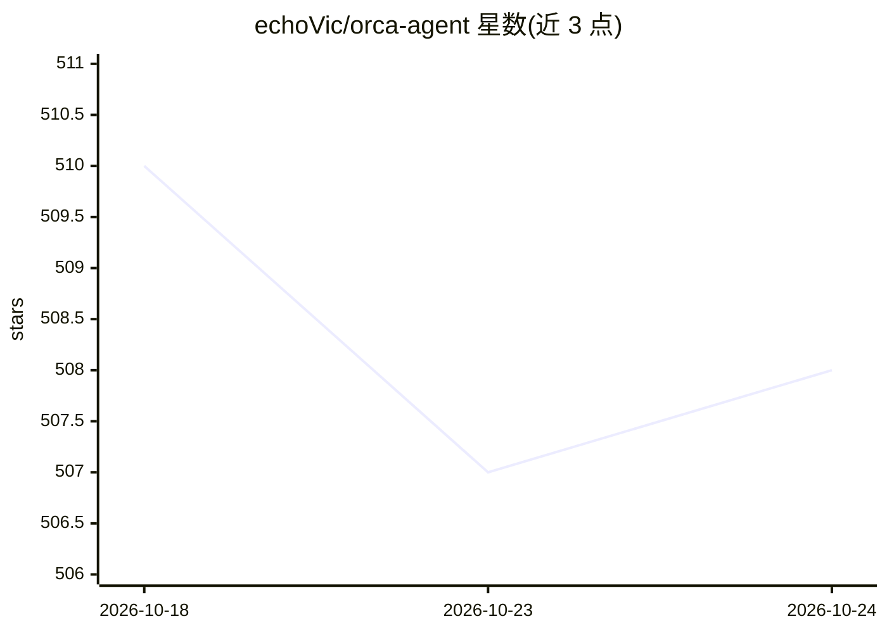

# echoVic/orca-agent

⭐ 509 · Rust · MIT · 推送 2026-10-24 · [GitHub](https://github.com/echoVic/orca-agent) · [官网](https://orcaagent.dev/) · 个人维护 · 中文 README

**DeepSeek 原生的终端编码 agent，读码改文件跑命令直至任务完成**

用 Rust 编写、本地运行的终端编码代理：接收任务后读取/搜索/编辑代码、运行 shell 命令、按指定命令验证结果，持续工作直到任务完成。直接使用 DeepSeek 推理与工具调用语义（SSE 流式、前缀缓存友好提示、自动上下文管理），默认模型 deepseek-flash，支持 1M token 上下文。提供 TUI 交互界面与 orca exec 无头模式，含四级审批模式（suggest/auto-edit/full-auto/plan）、沙箱、子代理、工作流、MCP 服务器管理与 ACP/JSONL 稳定契约。通过 npm 或安装脚本分发，macOS/Linux/Windows ARM64 与 x64 预编译。

## 筛选速览

| 维度 | 判定 | 备注 |
|---|---|---|
| AI 角色 | `ai-native` | 本体是模型或模型工具 |
| 许可风险 | `permissive` | MIT |
| 部署形态 | `desktop` | 安装包/桌面程序 |
| 模型依赖 | locked-api |  |
| 硬件要求 | — | 无带数字的原话,不猜 |
| 安装摩擦 | `low` | 无编译、无系统依赖或容器化 |
| 成熟度 | — | 结构信号不足 |

## 能力要点

- 直接使用 DeepSeek 推理与工具调用语义（SSE 流式、自动上下文管理、重试）
- 四级审批模式与按文件夹信任、OS 沙箱隔离
- 同步/异步子代理、工作流与持久化续跑（continuation id / checkpoint）
- MCP 服务器管理及 JSONL / ACP / app-server 稳定接口供编辑器与 CI 使用

## 适用场景

- 在终端用自然语言下达编码任务，让代理读码改文件并验证结果
- CI/脚本中以 orca exec 无头运行并按预算限制（turns/费用/时长）
- 通过 MCP 工具与 Pilion 浏览器集成扩展代理能力

## 场景标签

`编码 Agent` · 领域:编码与开发

## 证据(README 行号)

> L10: A DeepSeek-native coding agent for your terminal.
> L12: Give Orca a task and it reads code, edits files, runs commands, verifies the
> L153: - Uses DeepSeek's reasoning and tool-use semantics directly, with SSE streaming,

## 星数曲线

2026-10-18 510 → 2026-10-24 508（-2）

---
*卡片 v1 · prompt 1.4 · 生成 2026-10-22 · 置信度 high · 依据 README sha `b8a86324ef22` · [字段定义](../../DATASET.md)*
