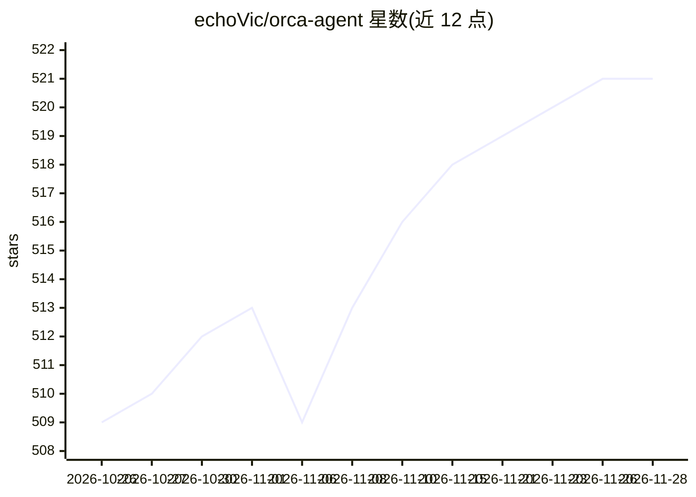

# echoVic/orca-agent

⭐ 521 · Rust · MIT · 推送 2026-11-27 · [GitHub](https://github.com/echoVic/orca-agent) · [官网](https://orcaagent.dev/) · 个人维护

**面向开发者的 DeepSeek 原生终端编码 Agent**

以 Rust 编写、本地运行的终端编码 Agent：接收任务后读取代码、编辑文件、执行 shell 命令并验证结果，直到任务完成或需要用户介入。提供交互式 TUI 与 `orca exec` 无头模式两种使用方式，支持 MCP 服务器接入、子代理与工作流、会话恢复/分叉、检查点回滚以及 suggest/auto-edit/full-auto/plan 四级审批模式。通过 npm 包或安装脚本分发，支持 macOS/Linux/Windows 的 ARM64 与 x64。

## 筛选速览

| 维度 | 判定 | 备注 |
|---|---|---|
| AI 角色 | `ai-native` | 本体是模型或模型工具 |
| 许可风险 | `permissive` | MIT |
| 部署形态 | `desktop` | 安装包/桌面程序 |
| 模型依赖 | locked-api |  |
| 硬件要求 | — | 无带数字的原话,不猜 |
| 安装摩擦 | `low` | 无编译、无系统依赖或容器化 |
| 成熟度 | — | 结构信号不足 |

## 能力要点

- 直接使用 DeepSeek 推理与工具调用语义，SSE 流式输出与自动上下文管理
- MCP 服务器后台连接，子代理/工作流的持久执行与续跑（resume_from/continuation id）
- 四级审批模式（suggest/auto-edit/full-auto/plan）加每目录信任机制
- 基于内容寻址检查点的 /rewind 回滚，最近 100 次编辑可恢复文件

## 适用场景

- 在终端里给 Agent 下达编码任务并自动完成文件修改与验证
- 通过 MCP 扩展工具并在 macOS 上操作其他应用完成 UI 相关工作
- 在 CI 或脚本中用 orca exec 无头运行编码任务
- 长时间任务中查看/控制后台子代理并随时回滚文件状态

## 场景标签

`编码 Agent` · 领域:编码与开发

## 证据(README 行号)

> L10: Orca Agent is a DeepSeek-native coding agent for your terminal.
> L177: - Uses DeepSeek's reasoning and tool-use semantics directly, with SSE streaming,

## 星数曲线

2026-10-26 509 → 2026-11-28 521（+12）

---
*卡片 v1 · prompt 1.4 · 生成 2026-11-28 · 置信度 high · 依据 README sha `113b0309643f` · [字段定义](../../DATASET.md)*
