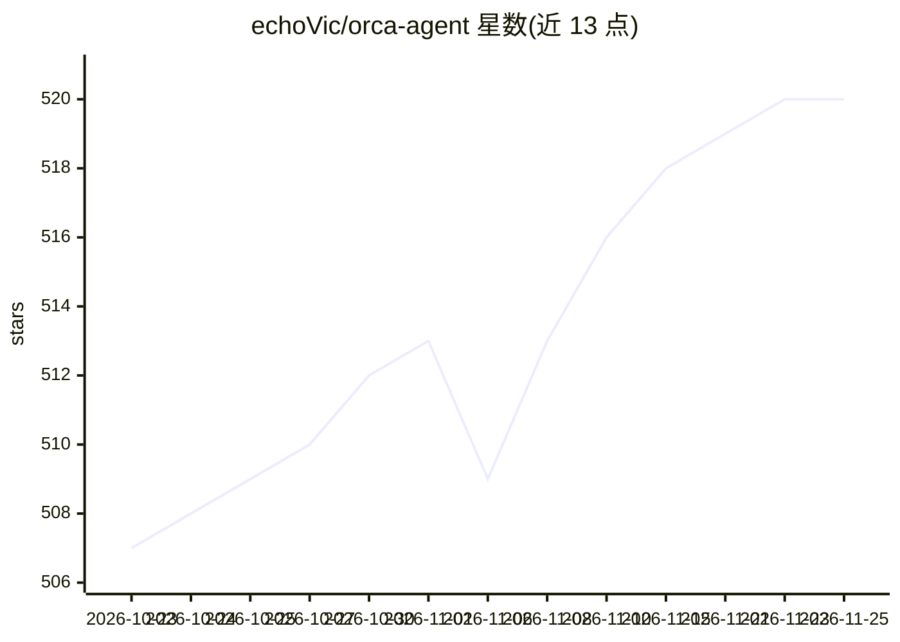

# echoVic/orca-agent

⭐ 520 · Rust · MIT · 推送 2026-11-23 · [GitHub](https://github.com/echoVic/orca-agent) · [官网](https://orcaagent.dev/) · 组织维护

**面向 DeepSeek 的终端编程 Agent：读码改文件跑命令**

Rust 编写的终端编码代理，接入 DeepSeek 推理与工具调用语义（SSE 流式、前缀缓存友好、自动上下文管理）。用户给出任务后，它读取代码、编辑文件、运行 shell 命令并验证结果，直至任务完成或请求人工介入。提供交互式 TUI 与无头 `orca exec` 两种使用方式，配合 suggest/auto-edit/full-auto/plan 四级审批模式与按目录信任机制；支持 MCP 服务器、子代理、JavaScript 工作流、会话恢复/分叉与检查点回退。通过 npm 或原生安装脚本分发，支持 macOS/Linux/Windows。

## 筛选速览

| 维度 | 判定 | 备注 |
|---|---|---|
| AI 角色 | `ai-native` | 本体是模型或模型工具 |
| 许可风险 | `permissive` | MIT |
| 部署形态 | `desktop` | 安装包/桌面程序 |
| 模型依赖 | locked-api |  |
| 硬件要求 | — | 无带数字的原话,不猜 |
| 安装摩擦 | `low` | 无编译、无系统依赖或容器化 |
| 成熟度 | — | 结构信号不足 |

## 能力要点

- 直接使用 DeepSeek 推理与工具调用语义，SSE 流式输出
- 四级执行模式（suggest/auto-edit/full-auto/plan）与按目录信任
- MCP 服务器管理与文件式子代理、JavaScript 工作流
- 基于内容寻址检查点的 /rewind 回退与任务后台运行

## 适用场景

- 在终端用自然语言委托编码任务并自动验证结果
- 脚本与 CI 中以无头模式运行编码代理
- 通过 MCP 接入自定义工具与资源
- macOS 上让代理操作 GUI 应用完成界面验证

## 场景标签

`编码 Agent` `GUI 自动化` · 领域:效率与自动化

## 证据(README 行号)

> L10: Orca Agent is a DeepSeek-native coding agent for your terminal.
> L177: - Uses DeepSeek's reasoning and tool-use semantics directly, with SSE streaming,
> L192: - Gates risky actions with `suggest`, sandboxed `auto-edit`, full-access

## 星数曲线

2026-10-23 507 → 2026-11-25 520（+13）

---
*卡片 v1 · prompt 1.4 · 生成 2026-11-25 · 置信度 high · 依据 README sha `2d5a2c567e53` · [字段定义](../../DATASET.md)*
