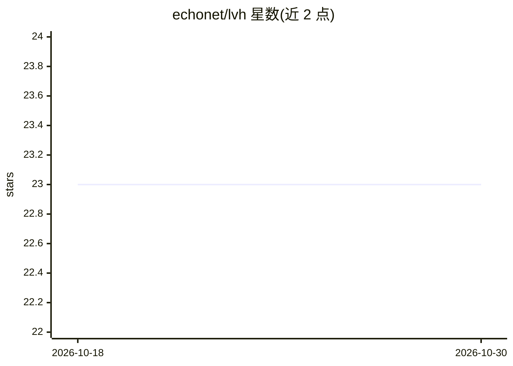

# echonet/lvh

⭐ 23 · Python · NOASSERTION · 推送 2026-05-01 · [GitHub](https://github.com/echonet/lvh) · 组织维护

**从超声心动图视频定量心室肥厚并预测病因的深度学习模型**

EchoNet-LVH 是一个深度学习工作流：输入 .avi 格式超声心动图视频，自动测量室间隔/左室后壁厚度与左室内径，并对心脏淀粉样变性、肥厚型心肌病等左室肥厚病因做分类预测。提供两个 CLI 推理脚本：PLAX 视角的厚度测量（输出逐帧预测 CSV、叠加预测的动画与时间曲线图）与 A4C 视角的二分类（整目录输出单个 CSV）。模型在 Stanford、Cedars-Sinai 等多中心数据上训练与外部验证，并随论文公开 12,000 条标注超声视频数据集。面向心血管影像研究人员与临床 AI 开发者。

## 筛选速览

| 维度 | 判定 | 备注 |
|---|---|---|
| AI 角色 | `ai-native` | 本体是模型或模型工具 |
| 许可风险 | `none` | NOASSERTION |
| 部署形态 | `None` |  |
| 模型依赖 | — | README 未给出锁定关系 |
| 硬件要求 | — | 无带数字的原话,不猜 |
| 安装摩擦 | `low` | 无编译、无系统依赖或容器化 |
| 成熟度 | — | 结构信号不足 |

## 能力要点

- PLAX 模型输出逐帧厚度测量（CSV + 叠加动画 + 时间曲线 PNG）
- A4C 模型对淀粉样变性/肥厚型心肌病等病因做视频二分类
- 跨多中心外部验证（国内与国际医疗系统）
- 随论文公开 12,000 条标注超声心动图视频数据集

## 适用场景

- 对超声心动图视频批量自动测量左室结构与壁厚
- 从超声视频预测左室肥厚病因（淀粉样变性、HCM 等）
- 作为心血管影像深度学习研究的数据集与基线模型

## 场景标签

 · 领域:医学影像/心血管诊断

## 证据(README 行号)

> L14: To overcome this challenge, we present a deep learning workflow that automatically quantifies ventricular hypertrop
> L18: Our deep learning algorithm accurately measures intraventricular wall thickness (mean absolute error [MAE] 1.4mm, 9
> L26: Running inference for the PLAX hypertrophy model is possible with ```run_plax_inference.py``` using a simple CLI. T

## 星数曲线



2026-10-18 23 → 2026-10-30 23（+0）


---
*卡片 v1 · prompt 1.4 · 生成 2026-10-27 · 置信度 high · 依据 README sha `8246f71f4d40` · [字段定义](../../DATASET.md)*
