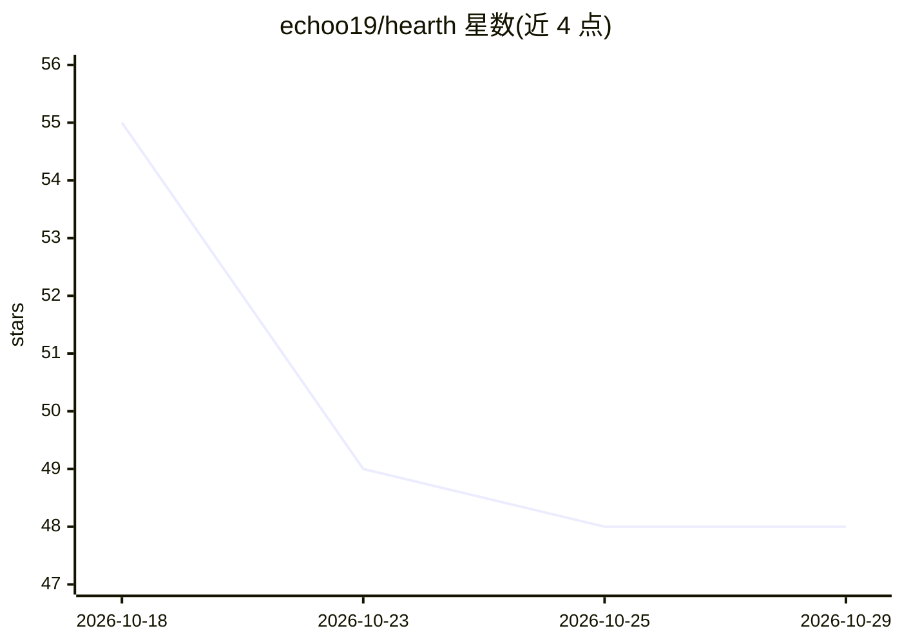

# echoo19/hearth

⭐ 48 · TypeScript · MIT · 推送 2026-10-05 · [GitHub](https://github.com/echoo19/hearth) · [官网](https://hearthengine.com) · 个人维护

**面向开放式游戏开发的 agent 桌面应用：对话即建游戏**

三栏桌面应用（macOS/Windows/Linux）：左侧项目列表、中间与编码 agent 对话、右侧运行游戏。用户输入想要的游戏，agent 写入普通文件夹的纯文件，浏览器可运行的内容即在窗格中运行；项目为普通文件夹，无专属项目格式。自带带记忆的试玩 agent，在自己的浏览器中游玩并记录发现（markdown 文件，可人工修改），按帧定位观察结果。接入用户已有的 agent（Claude Code、Codex CLI，或侧栏终端运行任意 agent CLI），另有 Dev Team 模式并行运行多个 agent 工程师。MIT 许可。

## 筛选速览

| 维度 | 判定 | 备注 |
|---|---|---|
| AI 角色 | `ai-native` | 本体是模型或模型工具 |
| 许可风险 | `permissive` | MIT |
| 部署形态 | `None` |  |
| 模型依赖 | locked-api |  |
| 硬件要求 | — | 无带数字的原话,不猜 |
| 安装摩擦 | `low` | 无编译、无系统依赖或容器化 |
| 成熟度 | — | 结构信号不足 |

## 能力要点

- 对话驱动 agent 生成游戏并在相邻窗格中持续运行
- 带持久记忆的试玩 agent：自动游玩、记录发现、判断改动是否有效
- 自带 agent（Claude Code/Codex CLI）或经终端运行任意 agent CLI
- 项目为普通文件夹（~/Hearth），对话与试玩记录随项目保存

## 适用场景

- 用自然语言让编码 agent 做出小游戏并即时查看运行效果
- 让 AI 试玩 agent 记录进度与卡点，验证每次改动是否奏效
- 以并行 Dev Team 模式让多个 agent 协作开发

## 场景标签

`编码 Agent` · 领域:编码与开发

## 证据(README 行号)

> L11: The Hearth window: a sidebar of project folders on the left, a conversation with a coding agent in the middle, and 
> L15: Type what you want to play. A coding agent builds it, and the game appears in
> L67: **Claude.** Hearth runs the Claude Code you are signed into, so an API key is

## 星数曲线

2026-10-18 55 → 2026-10-29 48（-7）

---
*卡片 v1 · prompt 1.4 · 生成 2026-10-25 · 置信度 high · 依据 README sha `9bdb7c13a933` · [字段定义](../../DATASET.md)*
