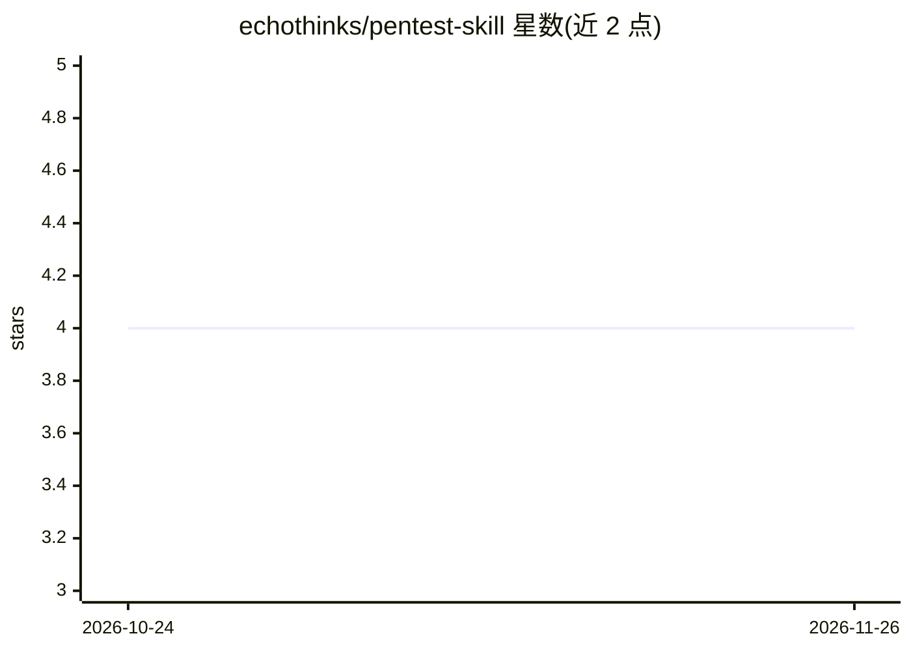

# echothinks/pentest-skill

⭐ 4 · HTML · NOASSERTION · 推送 2026-10-17 · [GitHub](https://github.com/echothinks/pentest-skill) · 个人维护 · 中文 README

**面向 AI Agent 的渗透测试方法论技能包与速查笔记**

按「流程 + 漏洞类型 + 工具链」组织的 Markdown 渗透测试知识库，整理自作者的渗透笔记与两张 xmind 脑图，只保留命令、payload、利用条件和判断思路。主入口 SKILL.md 含总流程、路由表与高频速查，按场景路由到 references/ 下的主题文件，采用按需读取设计。可通过 git clone 加载为 Claude Code / Hermes Agent 等框架的技能，也可当作纯笔记用 grep 或 Obsidian 查阅。README 附详细免责声明，限定授权测试使用。

## 筛选速览

| 维度 | 判定 | 备注 |
|---|---|---|
| AI 角色 | `ai-knowledge` | 知识聚合/清单类 |
| 许可风险 | `none` | NOASSERTION |
| 部署形态 | `None` |  |
| 模型依赖 | locked-api |  |
| 硬件要求 | — | 无带数字的原话,不猜 |
| 安装摩擦 | `low` | 无编译、无系统依赖或容器化 |
| 成熟度 | — | 结构信号不足 |

## 能力要点

- SKILL.md 路由表按场景指向 references/ 主题文件，按需读取
- 覆盖反弹 Shell、SQL 注入、文件上传/包含、SSRF、WAF 绕过、提权、内网横向等主题
- 支持加载为 Claude Code / Hermes Agent 技能，或并入 Cursor 等框架的 rules/instructions
- 提供带搜索过滤的 GitHub Pages 在线导航页

## 适用场景

- 授权渗透测试中按流程查阅命令与 payload 速查
- 把技能包加载到 Claude Code 辅助安全测试
- 搭建 sqli-labs / vulhub 等靶场做攻防练习
- CTF 备赛时当 Markdown 笔记随手翻查

## 场景标签

`网络安全` · 领域:学习与行业

## 证据(README 行号)

> L3: 一份面向实战的渗透测试知识库，按「流程 + 漏洞类型 + 工具链」组织。既可作为 AI Agent 的技能包（Claude Code / Hermes Agent / 其他支持 SKILL.md 的框架）直接加载，也可以当作纯 Ma
> L24: ├── SKILL.md                    # 主入口：总流程 + 路由 + 高频速查
> L29: **按需读取，不要一次全读**——`SKILL.md` 里有一张路由表，告诉你在什么场景下该翻哪个文件。

## 星数曲线

2026-10-24 4 → 2026-11-26 4（+0）

---
*卡片 v1 · prompt 1.4 · 生成 2026-11-21 · 置信度 high · 依据 README sha `7136d143ff4b` · [字段定义](../../DATASET.md)*
