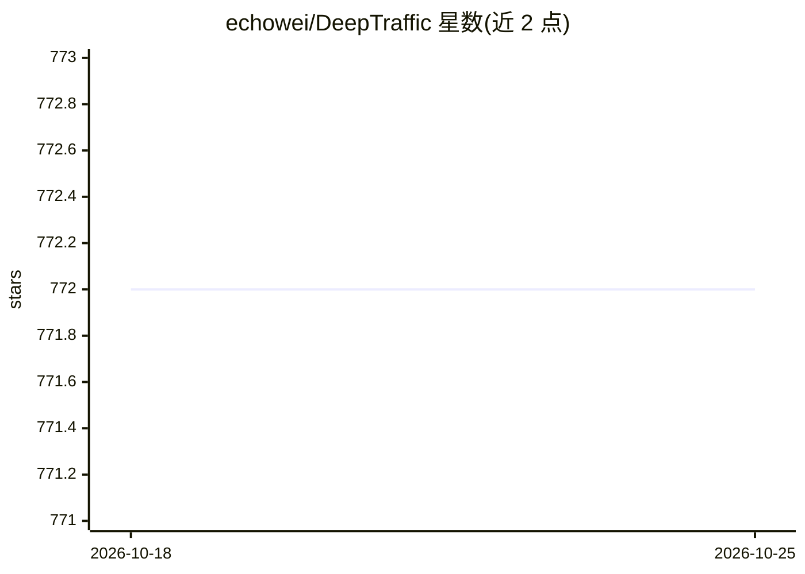

# echowei/DeepTraffic

⭐ 772 · Python · MPL-2.0 · 推送 2026-01-30 · [GitHub](https://github.com/echowei/DeepTraffic) · 个人维护 · 中文 README

**用深度学习做网络流量分类与入侵检测的模型代码库**

面向网络流量分析的研究型代码库，包含 CNN 用于恶意流量分类表示学习、一维 CNN 端到端加密流量分类、以及 HAST-IDS 层级时空特征深度神经网络入侵检测等论文的模型实现。README 主要列出相关论文与作者学术主页，未在可见内容中给出安装或运行说明，代码适用对象为科研与安全分析人员复现论文结果。

## 筛选速览

| 维度 | 判定 | 备注 |
|---|---|---|
| AI 角色 | `ai-native` | 本体是模型或模型工具 |
| 许可风险 | `permissive` | MPL-2.0 |
| 部署形态 | `None` |  |
| 模型依赖 | — | README 未给出锁定关系 |
| 硬件要求 | — | 无带数字的原话,不猜 |
| 安装摩擦 | `low` | 无编译、无系统依赖或容器化 |
| 成熟度 | — | 结构信号不足 |

## 能力要点

- CNN 用于恶意软件流量分类的表示学习实现
- 一维 CNN 端到端加密流量分类
- HAST-IDS 层级时空特征入侵检测模型

## 适用场景

- 复现论文中的流量分类与入侵检测模型
- 在恶意流量/加密流量数据集上做分类实验
- 为网络流量深度学习研究提供代码参考

## 场景标签

`科研工具` `网络安全` · 领域:学习与行业

## 证据(README 行号)

> L1: # Deep Learning models for network traffic classification
> L7: > ###### Wei Wang, Xuewen Zeng, Xiaozhou Ye, Yiqiang Sheng and Ming Zhu,"Malware Traffic Classification Using Convol
> L9: > ###### Wei Wang, Jinlin Wang, Xuewen Zeng, Zhongzhen Yang and Ming Zhu, "End-to-end Encrypted Traffic Classificati
> L11: > ###### Wei Wang, Yiqiang Sheng, Jinlin Wang, Xuewen Zeng, Xiaozhou Ye, Yongzhong Huang and Ming Zhu, "HAST-IDS: L

## 星数曲线

2026-10-18 772 → 2026-10-25 772（+0）

---
*卡片 v1 · prompt 1.4 · 生成 2026-10-21 · 置信度 mid · 依据 README sha `b8c29fb743d2` · [字段定义](../../DATASET.md)*
