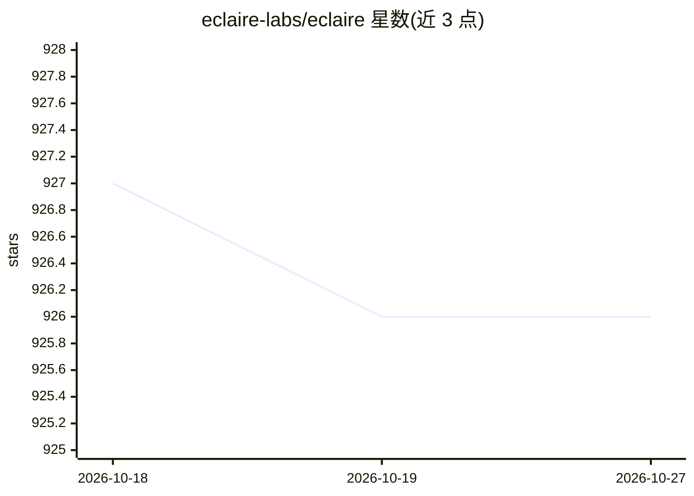

# eclaire-labs/eclaire

⭐ 926 · TypeScript · MIT · 推送 2026-05-14 · [GitHub](https://github.com/eclaire-labs/eclaire) · [官网](https://eclaire.co) · 组织维护

**本地优先的自托管 AI 助手：统一管理任务、笔记、文档、照片与书签**

面向个人数据管理的本地优先、开源自托管 AI 助手。将任务、笔记、文档、照片、书签等汇聚为统一数据层，提供带来源与工具调用的 AI 对话、OCR、文档解析、自动分类打标签与定时自动化任务。默认所有模型与数据本地运行，通过 OpenAI 兼容 API 接入 llama.cpp、vLLM、MLX、LM Studio、Ollama 等后端。以 Docker 一键部署为主，支持 macOS/Linux/Windows。README 声明处于 pre-release 阶段，会有频繁更新与破坏性变更，且不建议直接暴露公网。

## 筛选速览

| 维度 | 判定 | 备注 |
|---|---|---|
| AI 角色 | `ai-native` | 本体是模型或模型工具 |
| 许可风险 | `permissive` | MIT |
| 部署形态 | `self-host` | docker 或自建部署 |
| 模型依赖 | local-ok | 支持本地模型 |
| 硬件要求 | — | 无带数字的原话,不猜 |
| 安装摩擦 | `low` | 无编译、无系统依赖或容器化 |
| 成熟度 | `idea` | |

## 能力要点

- 统一数据层管理任务/笔记/文档/照片/书签，AI 带来源引用与工具调用
- 默认本地模型本地存储，通过 OpenAI 兼容 API 接入 llama.cpp/vLLM/MLX/LM Studio/Ollama
- 支持 Apple MLX 与 NVIDIA CUDA 等硬件加速
- setup.sh 一键 Docker 部署，支持 Telegram 集成与 PWA/移动端访问

## 适用场景

- 把散落的笔记、文档、照片、书签集中到私有平台并用 AI 检索总结
- 在本地模型上私密处理银行、健康等敏感信息
- 用 Apple Watch/手机随时口述笔记并让 AI 自动整理打标签
- 设置定时自动化（如每周一汇总本周任务）

## 场景标签

`AI 助手` `知识库管理` `文档解析` `OCR` · 领域:对话与助手

## 证据(README 行号)

> L53: **Eclaire** is a local-first, open-source AI that organizes, answers, and automates across tasks, notes, documents,
> L59: - **Self-hosted** - runs entirely on your hardware with local models and data storage
> L80: - **AI conversations**: chat with context from your content; see sources for answers; supports streaming and thinki

## 星数曲线

2026-10-18 927 → 2026-10-27 926（-1）

---
*卡片 v1 · prompt 1.4 · 生成 2026-10-21 · 置信度 high · 依据 README sha `da3a5bad5154` · [字段定义](../../DATASET.md)*
