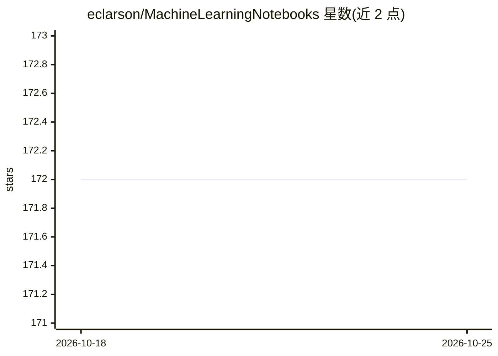

# eclarson/MachineLearningNotebooks

⭐ 172 · Jupyter Notebook · 推送 2026-10-22 · [GitHub](https://github.com/eclarson/MachineLearningNotebooks) · [官网](https://s2.smu.edu/~eclarson/teaching.html) · 组织维护

**SMU 神经网络课程讲义与代码仓库（CS5324/CS7324）**

SMU 课程 CS5324/CS7324《Neural Networks I》的教学仓库，前身课程名为 machine learning in python，包含 Jupyter Notebook 形式的讲义与代码，覆盖深度神经网络与机器学习内容。面向有 Python 编程经验和基础机器学习知识的学习者，作者声明代码可任意用途使用。README 按操作系统（Apple Silicon 与其他 OS）给出基于 conda + pip、Python 3.12 的环境搭建步骤，依赖 numpy、scikit-learn、tensorflow、torch、transformers 等库。

## 筛选速览

| 维度 | 判定 | 备注 |
|---|---|---|
| AI 角色 | `ai-knowledge` | 知识聚合/清单类 |
| 许可风险 | `none` | — |
| 部署形态 | `library` | 以包/库形式分发 |
| 模型依赖 | — | README 未给出锁定关系 |
| 硬件要求 | — | 无带数字的原话,不猜 |
| 安装摩擦 | `low` | 无编译、无系统依赖或容器化 |
| 成熟度 | — | 结构信号不足 |

## 能力要点

- Jupyter Notebook 形式的课程讲义与代码
- 区分 Apple Silicon 与其他 OS 的安装说明
- 基于 conda + pip 的 Python 3.12 环境配置
- 代码声明可任意用途使用

## 适用场景

- 学习神经网络与机器学习课程内容
- 参考 Python 3.12 + TensorFlow/PyTorch 的环境配置方法

## 场景标签

`教程课程` · 领域:学习与行业

## 证据(README 行号)

> L1: # Neural Networks I, SMU CS5324/CS7324
> L2: This is a repository for my course at SMU, CS5/7324, previously named machine learning in python. It should be acces

## 星数曲线

2026-10-18 172 → 2026-10-25 172（+0）

---
*卡片 v1 · prompt 1.4 · 生成 2026-10-22 · 置信度 high · 依据 README sha `3a4f37f90eb9` · [字段定义](../../DATASET.md)*
