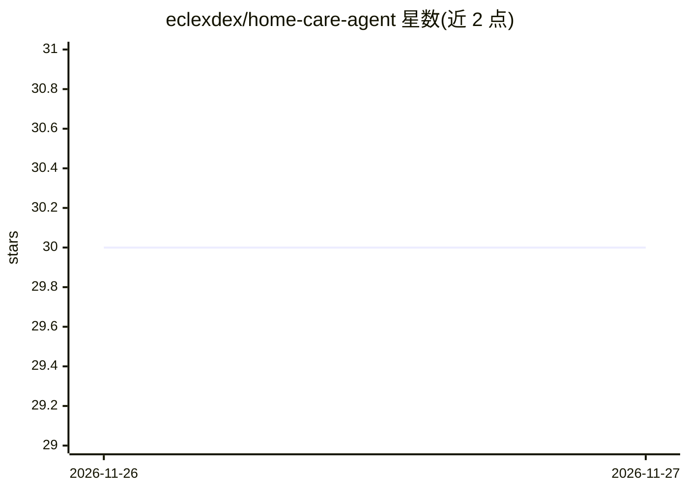

# eclexdex/home-care-agent

⭐ 30 · YAML · MIT · 推送 2026-11-25 · [GitHub](https://github.com/eclexdex/home-care-agent) · [官网](https://eclexdex.github.io/home-care-agent/) · 个人维护

**独居老人的 Home Assistant 本地照护安全包与可选 AI 日报**

面向独居老年成员家庭的 Home Assistant 本地照护包：提供五份可直接粘贴的 YAML 自动化（紧急按钮、Home/Away 布防、冻结/高温与电池告警、夜间路径照明、布防后门禁监视）及安装日操作手册；另含可选的本地 AI agent 层，通过只读令牌读取 HA API，生成每日家庭摘要与升级告警，Hermes 平台提供 skill 家族。全部本地运行、无云、无摄像头，明确声明非医疗设备、非跌倒检测。

## 筛选速览

| 维度 | 判定 | 备注 |
|---|---|---|
| AI 角色 | `ai-enhanced` | 去掉 AI 部分产品仍成立 |
| 许可风险 | `permissive` | MIT |
| 部署形态 | `None` |  |
| 模型依赖 | — | README 未给出锁定关系 |
| 硬件要求 | — | 无带数字的原话,不猜 |
| 安装摩擦 | `low` | 无编译、无系统依赖或容器化 |
| 成熟度 | — | 结构信号不足 |

## 能力要点

- 五份粘贴即用的 YAML 安全自动化与安装日 runbook
- 可选本地 AI agent 生成每日家庭摘要与告警转发（只读令牌，禁止操作设备）
- 三档硬件 BOM（Minimal/Standard/Comfort）与反 BOM 清单
- 本地优先、无摄像头、无健康推断的隐私约定（covenant）

## 适用场景

- 为独居父母搭建无月费的自托管紧急呼叫与门禁照护方案
- 冬季接收冻结/供暖故障与电池低电量告警
- 夜间起夜时自动点亮低位暖光路径降低跌倒风险
- 让本地 AI agent 向家庭群发送每日起居摘要

## 场景标签

`工作流自动化` `AI 助手` · 领域:效率与自动化

## 证据(README 行号)

> L7: A **local-first Home Assistant care-safety package** for an elderly family
> L80: - **The agent is optional.** The automations stand alone. The agent adds
> L111: 4. **Optional: the agent.** Point a local-first AI agent at the HA API with a

## 星数曲线

2026-11-26 30 → 2026-11-27 30（+0）

---
*卡片 v1 · prompt 1.4 · 生成 2026-11-26 · 置信度 high · 依据 README sha `732684834696` · [字段定义](../../DATASET.md)*
