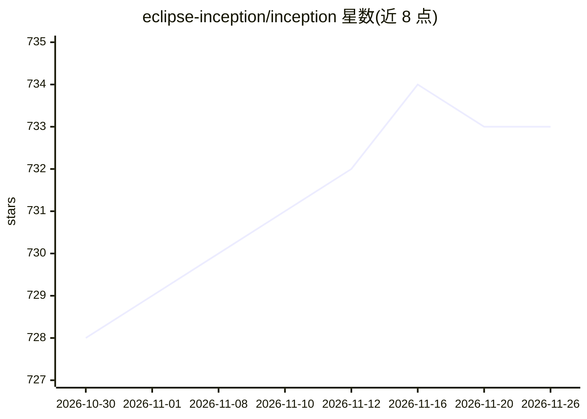

# eclipse-inception/inception

⭐ 733 · Java · Apache-2.0 · 推送 2026-11-25 · [GitHub](https://github.com/eclipse-inception/inception) · [官网](https://eclipse-inception.github.io) · 组织维护

**语义文本标注平台：知识库实体链接+机器辅助建议**

INCEpTION 是一个语义标注平台，用于按自定义标注体系构建多层文本标注语料，并将其挂接到自有本体。支持加载 RDF/OWL/OBO/SKOS/Turtle 或查询远程 SPARQL 端点，预置 Wikidata、SNOMED CT、Gene Ontology 等知识库配置；实体、关系、共指、句法等可在同一文本上叠加多层标注。推荐器随标注进度在已有数据上训练生成建议，主动学习挑选最不确定的样例询问，采纳后才存储；支持多标注者金标准校对、一致性度量，以及通过 REST API、webhooks 和外部推荐器模型集成。提供单机安装包与服务器部署两种形态。

## 筛选速览

| 维度 | 判定 | 备注 |
|---|---|---|
| AI 角色 | `ai-enhanced` | 去掉 AI 部分产品仍成立 |
| 许可风险 | `permissive` | Apache-2.0 |
| 部署形态 | `None` |  |
| 模型依赖 | — | README 未给出锁定关系 |
| 硬件要求 | — | 无带数字的原话,不猜 |
| 安装摩擦 | `low` | 无编译、无系统依赖或容器化 |
| 成熟度 | — | 结构信号不足 |

## 能力要点

- 多层标注：实体、关系、共指、句法、frames 在同一文本叠加，浏览器内定义
- 推荐器随标注训练生成建议，主动学习挑选低置信样例，采纳才入库
- 支持 RDF/OWL/OBO/SKOS/Turtle 本体与远程 SPARQL 查询，预置 Wikidata/SNOMED CT 等配置
- 提供 REST API、webhooks 与外部推荐器模型接入

## 适用场景

- 为 NLP 项目构建带自定义体系的标注语料
- 结合 Wikidata 或领域本体做实体链接标注
- 组织多人标注并校对成金标准数据集
- 以服务器形式为机构内团队部署标注环境

## 场景标签

`科研工具` · 领域:学习与行业

## 证据(README 行号)

> L28: - **Get suggestions that improve while you work.** Recommenders train on what you have annotated so
> L33: - **Runs where you need it to run.** A desktop installer for one person, or a server deployment for
> L5:  Multi-layer text annotation with knowledge-base entity linking and machine-assisted suggestions.

## 星数曲线

2026-10-30 728 → 2026-11-26 733（+5）

---
*卡片 v1 · prompt 1.4 · 生成 2026-11-24 · 置信度 high · 依据 README sha `4f1598dc3306` · [字段定义](../../DATASET.md)*
