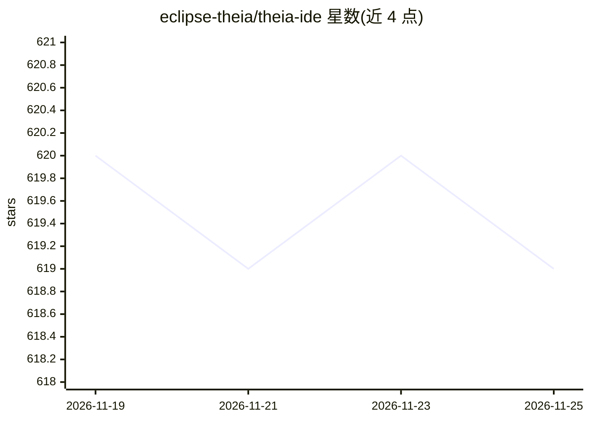

# eclipse-theia/theia-ide

⭐ 619 · TypeScript · MIT · 推送 2026-11-23 · [GitHub](https://github.com/eclipse-theia/theia-ide) · [官网](https://theia-ide.org/) · 组织维护

**面向云与桌面的开源 AI IDE，支持自带 LLM 密钥**

Eclipse Theia IDE 是基于 Theia 平台构建的开源 IDE，提供桌面安装包、在线试用版（每次会话 30 分钟）和实验性 Docker 镜像三种形态。同时作为模板供开发者基于 Theia 平台打包自己的桌面产品。仓库内容以构建与打包为主：yarn 构建 dev/production 版本、Electron 打包、浏览器版启动、E2E 测试。Linux AppImage 分发依赖 libfuse2，Docker 镜像目前处于实验状态。AI 相关能力（BYOK、MCP、Claude Code、Copilot 支持）在描述与主题标签中声明，README 正文未展开。

## 筛选速览

| 维度 | 判定 | 备注 |
|---|---|---|
| AI 角色 | `ai-enhanced` | 去掉 AI 部分产品仍成立 |
| 许可风险 | `permissive` | MIT |
| 部署形态 | `self-host` | docker 或自建部署 |
| 模型依赖 | — | README 未给出锁定关系 |
| 硬件要求 | — | 无带数字的原话,不猜 |
| 安装摩擦 | `low` | 无编译、无系统依赖或容器化 |
| 成熟度 | — | 结构信号不足 |

## 能力要点

- 桌面（Electron）、浏览器、Docker 三种运行形态
- 作为模板支持基于 Theia 平台定制打包产品
- 描述中声明 BYOK、MCP、Agent Skills、Claude Code 与 GitHub Copilot 支持

## 适用场景

- 下载桌面安装包作为日常开发 IDE 使用
- 基于 Theia 平台模板构建自己的定制 IDE
- 通过 Docker 镜像在浏览器中托管 Theia IDE

## 场景标签

`编码 Agent` · 领域:编码与开发

## 证据(README 行号)

> L24: The Eclipse Theia IDE is a modern and open IDE for cloud and desktop. The Theia IDE is based on the Theia platform.
> L25: The Theia IDE is available as a downloadable desktop application. You can also try the latest version of the Theia 
> L27: The Eclipse Theia IDE also serves as a **template** for building desktop-based products based on the Eclipse Theia 

## 星数曲线

2026-11-19 620 → 2026-11-25 619（-1）

---
*卡片 v1 · prompt 1.4 · 生成 2026-11-19 · 置信度 mid · 依据 README sha `eb9fd6d8b870` · [字段定义](../../DATASET.md)*
