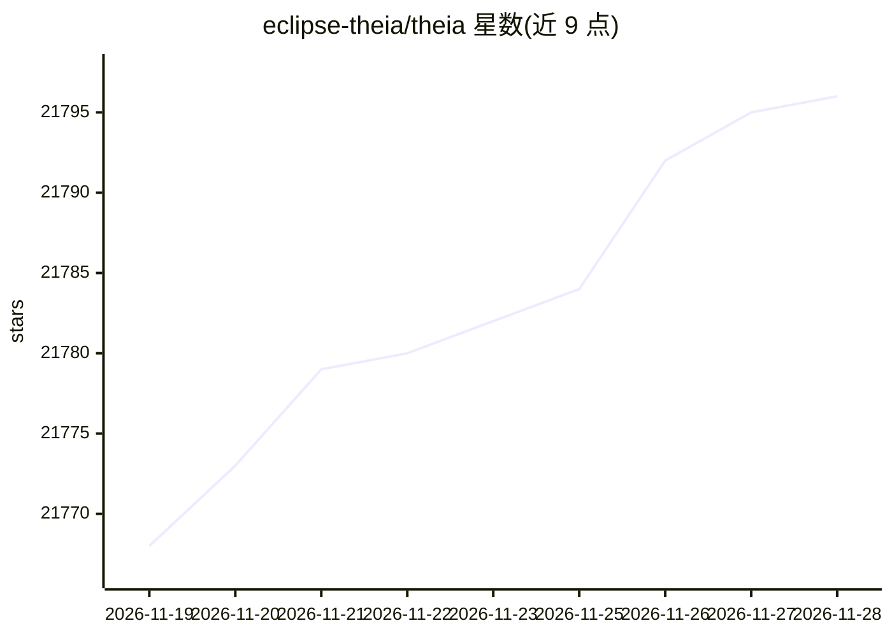

# eclipse-theia/theia

⭐ 21,796 · TypeScript · EPL-2.0 · 推送 2026-11-27 · [GitHub](https://github.com/eclipse-theia/theia) · [官网](https://theia-ide.org/) · 组织维护

**供开发者构建浏览器与桌面自定义 IDE 的开源框架**

Eclipse Theia 是一个可扩展框架，使用 Web 技术构建多语言的云端与桌面 IDE 及工具，支持 VS Code 扩展协议，采用厂商中立的开放源码治理。描述中提到包含 Theia AI——一个厂商中立的 AI harness 平台，并支撑 AI-native 的 Theia IDE。README 本体主要给出仓库定位、发布渠道、开发入门指南、贡献与文档链接，未给出具体安装命令或系统依赖说明。

## 筛选速览

| 维度 | 判定 | 备注 |
|---|---|---|
| AI 角色 | `ai-ecosystem` | LLM/agent 周边工具 |
| 许可风险 | `viral` | EPL-2.0 |
| 部署形态 | `None` |  |
| 模型依赖 | — | README 未给出锁定关系 |
| 硬件要求 | — | 无带数字的原话,不猜 |
| 安装摩擦 | `low` | 无编译、无系统依赖或容器化 |
| 成熟度 | — | 结构信号不足 |

## 能力要点

- 支持构建浏览器端与桌面端 IDE 和工具（Electron 打包指南）
- 兼容 VS Code 扩展协议，可开发与测试 VS Code 扩展
- 提供灵活架构供采纳者定制自己的 IDE/工具
- 每次发布生成 SBOM 并发布至 Eclipse Foundation SBOM 注册表

## 适用场景

- 基于 Theia 开发属于自己团队的自定义 IDE 或工具
- 将 Theia 应用打包为 Electron 桌面应用
- 在 Theia 中运行和测试已有的 VS Code 扩展

## 场景标签

`Agent 框架` · 领域:Agent 开发

## 证据(README 行号)

> L10: Eclipse Theia is an extensible framework to develop full-fledged multi-language Cloud & Desktop IDEs and tools with
> L33: - Support building browser-based and desktop IDEs and tools

## 星数曲线

2026-11-19 21,768 → 2026-11-28 21,796（+28）

---
*卡片 v1 · prompt 1.4 · 生成 2026-11-19 · 置信度 mid · 依据 README sha `2594c2ec4b33` · [字段定义](../../DATASET.md)*
