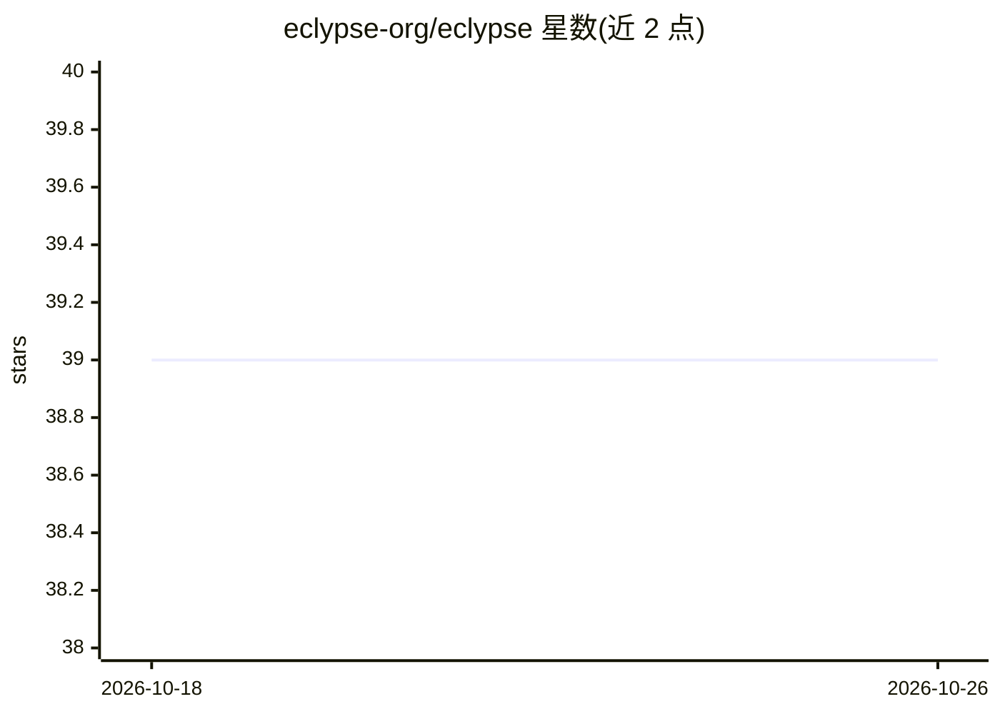

# eclypse-org/eclypse

⭐ 39 · Python · MIT · 推送 2026-10-23 · [GitHub](https://github.com/eclypse-org/eclypse) · [官网](https://eclypse.readthedocs.io) · 组织维护

**云-边连续体仿真与模拟的 Python 实验平台**

ECLYPSE 是一个纯 Python 编写的仿真库，用于在变化的基础设施条件下实验服务化应用的部署策略：提供接口将部署模拟到仿真的云-边基础设施上，可选择是否挂接真实应用实现（仿真/模拟两种模式）。面向做云边部署、资源编排研究的科研人员与开发者。通过 pip 安装，建议使用虚拟环境，配套文档与 2026 年期刊论文。

## 筛选速览

| 维度 | 判定 | 备注 |
|---|---|---|
| AI 角色 | `ai-ecosystem` | LLM/agent 周边工具 |
| 许可风险 | `permissive` | MIT |
| 部署形态 | `library` | 以包/库形式分发 |
| 模型依赖 | — | README 未给出锁定关系 |
| 硬件要求 | — | 无带数字的原话,不猜 |
| 安装摩擦 | `low` | 无编译、无系统依赖或容器化 |
| 成熟度 | — | 结构信号不足 |

## 能力要点

- 纯 Python 实现的云-边连续体仿真库
- 支持在有无真实应用实现两种模式下模拟部署
- 面向基础设施条件变化下的部署策略实验

## 适用场景

- 在仿真基础设施上实验服务部署策略
- 不实现真实应用即可评估云-边部署方案
- 以模拟方式在受控环境中运行真实应用组件

## 场景标签

`科研工具` · 领域:学习与行业

## 证据(README 行号)

> L14: **ECLYPSE** (**E**dge-**CL**oud p**Y**thon **P**latform for **S**imulated runtime **E**nvironments) is the first si
> L36: > Jacopo Massa, Valerio De Caro, Stefano Forti, Patrizio Dazzi, Davide Bacciu, Antonio Brogi
> L37: > **ECLYPSE: a Python Framework for Simulation and Emulation of the Cloud-Edge Continuum**,

## 星数曲线

2026-10-18 39 → 2026-10-26 39（+0）

---
*卡片 v1 · prompt 1.4 · 生成 2026-10-25 · 置信度 mid · 依据 README sha `650ab512ece2` · [字段定义](../../DATASET.md)*
