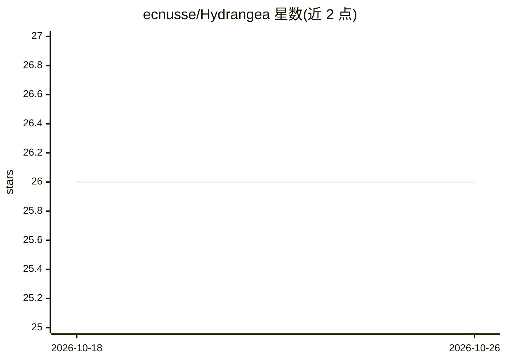

# ecnusse/Hydrangea

⭐ 26 · Python · NOASSERTION · 推送 2025-12-31 · [GitHub](https://github.com/ecnusse/Hydrangea) · 组织维护 · 中文 README

**LLM 软件缺陷库：100 个项目的缺陷类型与触发测试数据集**

ICSE2025 论文 "Are LLMs Correctly Integrated into Software Systems?" 的工件：面向集成了 LLM 与向量数据库（RAG）的软件，按 LLM agent、向量数据库、软件组件、系统四个组成部分归档缺陷。包含 application.csv（100 个项目及其 LLM/向量数据库信息）与 defect.csv（缺陷类型、源码位置、后果、触发测试），并提供 hydrangea CLI（apps/bids/info/test 命令）查询与过滤数据。以 CSV 数据集加命令行工具形式提供，PDDL 公有领域许可发布，所研究案例之一被分配 CVE-2025-45150。

## 筛选速览

| 维度 | 判定 | 备注 |
|---|---|---|
| AI 角色 | `ai-knowledge` | 知识聚合/清单类 |
| 许可风险 | `none` | NOASSERTION |
| 部署形态 | `library` | 以包/库形式分发 |
| 模型依赖 | — | README 未给出锁定关系 |
| 硬件要求 | — | 无带数字的原话,不猜 |
| 安装摩擦 | `low` | 无编译、无系统依赖或容器化 |
| 成熟度 | — | 结构信号不足 |

## 能力要点

- 覆盖 100 个集成 LLM 与向量数据库的项目的缺陷库
- 按 4 个组成部分（LLM agent/向量数据库/软件组件/系统）组织缺陷类型
- 每条缺陷含类型、解释、源码位置、后果与触发测试
- 提供 hydrangea CLI 支持按 LLM/向量数据库/语言多维过滤查询

## 适用场景

- 查找特定 LLM 或向量数据库应用中的已知缺陷类型
- 复现论文中的缺陷触发测试以验证修复
- 为 LLM 软件测试与缺陷检测研究提供数据集

## 场景标签

 · 领域:软件工程/LLM 应用质量

## 证据(README 行号)

> L15: Hydrangea is a defect library for LLM-enabled software. Hydrangea has 4 main petals, each corresponding to one of t
> L35: For enhanced availability and reusability, we offer an organized defect library utilized in our manual studies.

## 星数曲线

2026-10-18 26 → 2026-10-26 26（+0）

---
*卡片 v1 · prompt 1.4 · 生成 2026-10-26 · 置信度 high · 依据 README sha `593a0598710e` · [字段定义](../../DATASET.md)*
