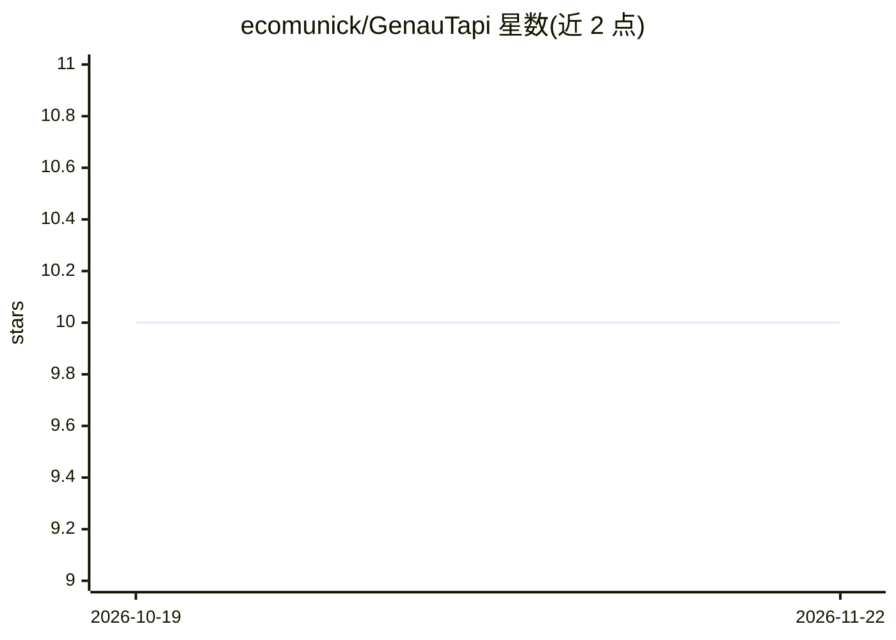

# ecomunick/GenauTapi

⭐ 10 · Swift · MIT · 推送 2026-01-12 · [GitHub](https://github.com/ecomunick/GenauTapi) · 个人维护

**德语学习者的 AI 口语与语法对话教练**

面向德语学习者的对话式语言助手：通过 FastAPI 后端调用 GPT-4o-mini 生成对话回复，以 tts-1 模型输出语音，支持网页端 Push-to-Talk 语音交互；用 PostgreSQL 按会话 ID 持久化聊天历史，并以摘要形式维护跨会话的记忆上下文，使问候与话题个性化。采用 openapi.yaml 定义接口契约，提供 Swagger 文档、pytest 集成测试、Docker Compose 部署与 Render 托管，为 DataTalksClub AI Dev Tools Zoomcamp 项目。

## 筛选速览

| 维度 | 判定 | 备注 |
|---|---|---|
| AI 角色 | `ai-native` | 本体是模型或模型工具 |
| 许可风险 | `permissive` | MIT |
| 部署形态 | `self-host` | docker 或自建部署 |
| 模型依赖 | — | README 未给出锁定关系 |
| 硬件要求 | — | 无带数字的原话,不猜 |
| 安装摩擦 | `low` | 无编译、无系统依赖或容器化 |
| 成熟度 | — | 结构信号不足 |

## 能力要点

- 跨会话的分布式记忆上下文 + PostgreSQL 会话持久化
- OpenAI tts-1（nova 音色）语音输出与 Push-to-Talk 网页交互
- openapi.yaml 契约优先设计，自动生成 Swagger 文档
- Docker Compose 一键启动并自动执行数据库迁移

## 适用场景

- 和 AI 语音对话练习德语口语
- 在对话中获得语法提示而不过度打断
- 部署一个带持久记忆的多会话语言学习助手

## 场景标签

`语音 Agent` · 领域:对话与助手

## 证据(README 行号)

> L2: > *Your AI-Powered German Language Coach*
> L18: - **Distributed Context**: Tapi maintains a "Memory Context" (summarized history) that persists across sessions.
> L34:  - `openai`: GPT-4o-mini for logic, TTS-1 for voice.

## 星数曲线

2026-10-19 10 → 2026-11-22 10（+0）

---
*卡片 v1 · prompt 1.4 · 生成 2026-11-19 · 置信度 high · 依据 README sha `f99471b8f7d5` · [字段定义](../../DATASET.md)*
