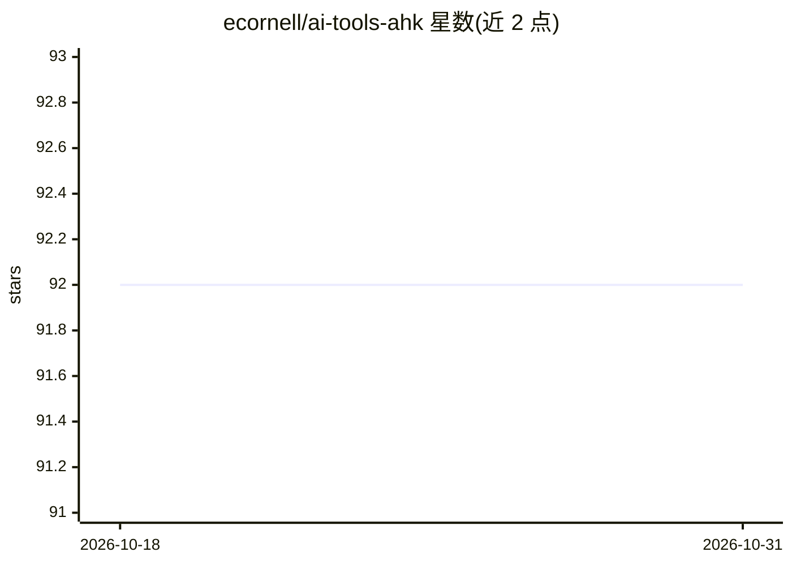

# ecornell/ai-tools-ahk

⭐ 92 · AutoHotkey · MIT · 推送 2025-11-26 · [GitHub](https://github.com/ecornell/ai-tools-ahk) · 个人维护

**Windows 全局热键工具：在任意窗口对文本运行自定义 AI 提示词**

基于 AutoHotkey v2 的 Windows 便携工具：通过全局热键自动选中当前行/段落或手动选择文本，发送到自定义 AI 提示词并将结果替换回原文，实现任意窗口内的 AI 文本编辑。支持三种 API 提供商（OpenAI、Azure OpenAI、Google Gemini），可在 settings.ini 中配置热键、提示词、模型与提供商切换，单个提示词可覆盖全局模式。以 .zip 发行包或 .exe 便携运行，无需安装；兼容性在 Windows 10/11 上测试。

## 筛选速览

| 维度 | 判定 | 备注 |
|---|---|---|
| AI 角色 | `ai-native` | 本体是模型或模型工具 |
| 许可风险 | `permissive` | MIT |
| 部署形态 | `desktop` | 安装包/桌面程序 |
| 模型依赖 | locked-api |  |
| 硬件要求 | — | 无带数字的原话,不猜 |
| 安装摩擦 | `low` | 无编译、无系统依赖或容器化 |
| 成熟度 | — | 结构信号不足 |

## 能力要点

- 全局热键在任意 Windows 窗口对选中或自动选择的文本运行自定义提示词
- 支持 OpenAI、Azure OpenAI、Google Gemini 三种 API 提供商，可按提示词覆盖
- settings.ini 配置热键、提示词与模型，支持开机自启
- 便携运行，无需安装，提供 .ahk 与 .exe 两种运行方式

## 适用场景

- 在任意应用中一键修正拼写或运行常用 AI 文本处理
- 编辑器、聊天框等未集成 AI 的窗口里获得 AI 文本改写
- 按场景配置多套提示词并通过热键快速调用

## 场景标签

`AI 写作` · 领域:内容生成

## 证据(README 行号)

> L7: This is a Windows tool that enables running custom AI prompts on text in any window using global hotkeys.
> L9: i.e. Low-friction AI text editing ("spicy autocomplete") anywhere in Windows.

## 星数曲线

2026-10-18 92 → 2026-10-31 92（+0）

---
*卡片 v1 · prompt 1.4 · 生成 2026-10-23 · 置信度 high · 依据 README sha `bd565f4b7b4b` · [字段定义](../../DATASET.md)*
