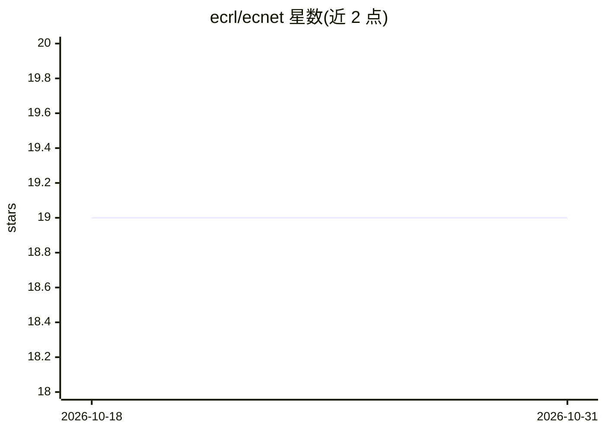

# ecrl/ecnet

⭐ 19 · Python · MIT · 推送 2026-09-07 · [GitHub](https://github.com/ecrl/ecnet) · [官网](https://ecnet.readthedocs.io/en/latest/) · 组织维护

**QSPR+PyTorch 燃料性质预测库：由分子结构预测燃料属性**

开源 Python 包，基于定量结构–性质关系（QSPR）描述符与 PyTorch 多层感知机，从分子结构预测燃料性质（如十六烷值）。v4 API 提供 ECNet 主类、捆绑数据集加载器（ecnet.datasets.load_*）、超参数调优辅助、训练回调与解析式混合物性质方程。描述符后端默认 PaDEL-Descriptor，可选 alvaDesc（需有效许可）。运行需 Python 3.11+ 与 Java（PaDEL 后端）。2017 年 JOSS 论文描述的旧架构已非当前 API。

## 筛选速览

| 维度 | 判定 | 备注 |
|---|---|---|
| AI 角色 | `ai-native` | 本体是模型或模型工具 |
| 许可风险 | `permissive` | MIT |
| 部署形态 | `library` | 以包/库形式分发 |
| 模型依赖 | — | README 未给出锁定关系 |
| 硬件要求 | — | 无带数字的原话,不猜 |
| 安装摩擦 | `low` | 无编译、无系统依赖或容器化 |
| 成熟度 | — | 结构信号不足 |

## 能力要点

- QSPR 描述符 + PyTorch 多层感知机预测燃料性质
- 捆绑数据集加载器与数据卡片
- 超参数调优辅助与训练回调
- 解析式混合物（blend）性质计算，支持 PaDEL/alvaDesc 描述符后端

## 适用场景

- 由分子结构预测燃料的十六烷值等性质
- 对混合燃料按组分估算整体性质
- 构建与调优 QSPR 神经网络模型并复用捆绑数据集

## 场景标签

 · 领域:计算化学/能源

## 证据(README 行号)

> L11: **ECNet** is an open-source Python package for predicting fuel properties from
> L12: molecular structure using quantitative structure–property relationship (QSPR)

## 星数曲线

2026-10-18 19 → 2026-10-31 19（+0）

---
*卡片 v1 · prompt 1.4 · 生成 2026-10-28 · 置信度 high · 依据 README sha `3856525764e7` · [字段定义](../../DATASET.md)*
