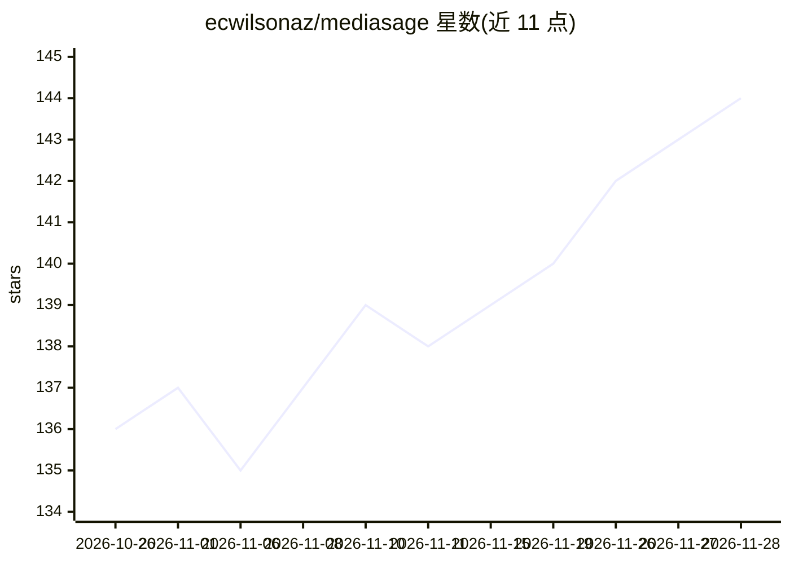

# ecwilsonaz/mediasage

⭐ 144 · Python · MIT · 推送 2026-11-18 · [GitHub](https://github.com/ecwilsonaz/mediasage) · 个人维护

**自托管 Plex/Jellyfin 音乐库的 AI 歌单与专辑推荐工具**

MediaSage 是一个自托管 Web 应用，结合 LLM 与用户的 Plex 或 Jellyfin 音乐库生成播放列表并推荐专辑。其机制为"先过滤"：先按流派、年代、艺人、评分等条件筛选本地库，再将候选池交给 LLM，保证每条建议均可播放。库数据同步到本地 SQLite 缓存，过滤与计数在本地完成；支持多 LLM 提供商（含本地 Ollama）、定时刷新歌单、直接推送播放到 Plex 设备。无登录机制，需置于可信网络。

## 筛选速览

| 维度 | 判定 | 备注 |
|---|---|---|
| AI 角色 | `ai-native` | 本体是模型或模型工具 |
| 许可风险 | `permissive` | MIT |
| 部署形态 | `self-host` | docker 或自建部署 |
| 模型依赖 | local-ok | 支持本地模型 |
| 硬件要求 | — | 无带数字的原话,不猜 |
| 安装摩擦 | `low` | 无编译、无系统依赖或容器化 |
| 成熟度 | — | 结构信号不足 |

## 能力要点

- Filter-First 机制：AI 仅在用户自有曲库范围内推荐，歌单不为空
- 本地 SQLite 库缓存与增量同步（Plex），过滤/计数在本地毫秒级完成
- 多提供商支持：Google Gemini、Anthropic Claude、OpenAI GPT、Ollama 及 OpenAI 兼容自定义 API，含成本预估显示
- 歌单定时自动刷新，失败 3 次自动暂停

## 适用场景

- 为 Plex/Jellyfin 自有音乐库按心情描述生成可立即播放的歌单
- 获得基于个人口味画像的专辑推荐（含 Discovery 模式发现未购专辑）
- 在 NAS（Synology/Unraid/TrueNAS）上自托管运行
- 用本地模型（Ollama）在无外部 API 成本下生成歌单

## 场景标签

`推荐系统` · 领域:学习与行业

## 证据(README 行号)

> L9: MediaSage is a self-hosted web app that creates playlists and recommends albums by combining LLM intelligence with y
> L41: **Requirements:** Docker, a Plex server with music and a Plex token (or a Jellyfin server with music and a Jellyfin
> L124: ### Multi-Provider Support

## 星数曲线

2026-10-26 136 → 2026-11-28 144（+8）

---
*卡片 v1 · prompt 1.4 · 生成 2026-11-27 · 置信度 high · 依据 README sha `68b03dc7b770` · [字段定义](../../DATASET.md)*
