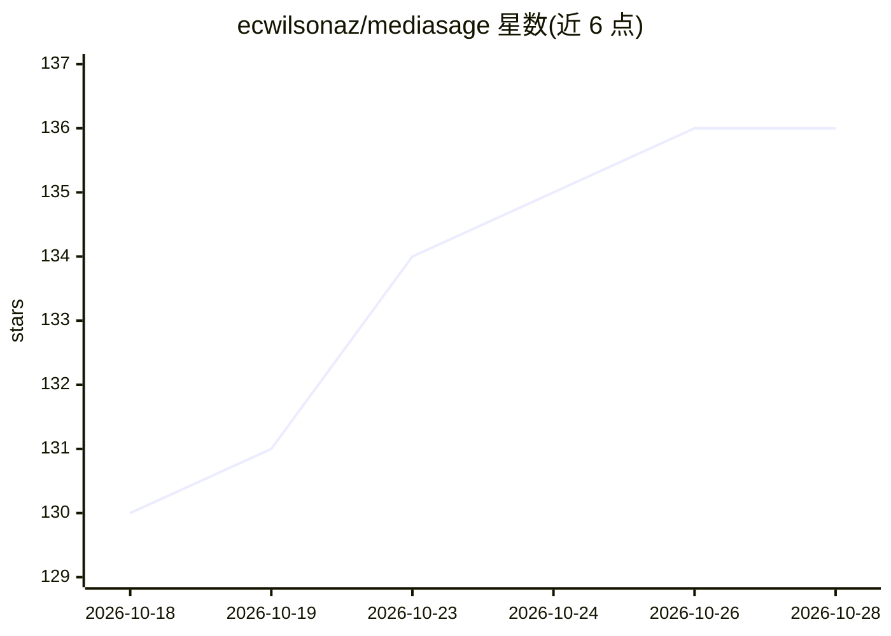

# ecwilsonaz/mediasage

⭐ 136 · Python · MIT · 推送 2026-02-20 · [GitHub](https://github.com/ecwilsonaz/mediasage) · 个人维护

**自托管 Web 应用：用 LLM 从 Plex 音乐库生成歌单与专辑推荐**

面向 Plex 用户自托管的 Web 应用（Python+FastAPI，Docker 部署）。采用 filter-first 架构：先把曲库按流派/年代/评分过滤，再交给 LLM 从中选曲，保证歌单内每首曲子都在用户曲库中可播放。功能包括自然语言生成歌单、从种子歌曲探索、专辑推荐（曲库模式/发现模式）、推送到 Plex 设备播放。曲库同步到本地 SQLite 缓存加速操作。支持 Google Gemini/Anthropic/OpenAI API key，也可经 Ollama 或自定义 OpenAI 兼容端点运行本地模型（实验性）。

## 筛选速览

| 维度 | 判定 | 备注 |
|---|---|---|
| AI 角色 | `ai-native` | 本体是模型或模型工具 |
| 许可风险 | `permissive` | MIT |
| 部署形态 | `self-host` | docker 或自建部署 |
| 模型依赖 | local-ok | 支持本地模型 |
| 硬件要求 | — | 无带数字的原话,不猜 |
| 安装摩擦 | `low` | 无编译、无系统依赖或容器化 |
| 成熟度 | `idea` | |

## 能力要点

- filter-first 架构：LLM 只看到用户曲库，生成结果全部可播放
- 多提供商支持：Gemini/Anthropic/OpenAI/Ollama/自定义 OpenAI 兼容端点
- 曲库同步至本地 SQLite 缓存，过滤与计数本地毫秒级完成
- 提供 Synology/Unraid/TrueNAS/Portainer 等部署指南与裸机 Python 运行方式

## 适用场景

- 用自然语言从自己拥有的音乐里生成可立即播放的歌单
- 基于心情获得专辑推荐（含曲库内即播与发现两种模式）
- 在没有 Docker 的 ARM NAS 或树莓派上用 Python 直接运行

## 场景标签

`推荐系统` · 领域:学习与行业

## 证据(README 行号)

> L10: MediaSage is a self-hosted web app that creates playlists and recommends albums by combining LLM intelligence with 
> L42: **Requirements:** Docker, a Plex server with music, a Plex token, and an API key from Google, Anthropic, or OpenAI 
> L106: ### Multi-Provider Support

## 星数曲线

2026-10-18 130 → 2026-10-28 136（+6）

---
*卡片 v1 · prompt 1.4 · 生成 2026-10-23 · 置信度 mid · 依据 README sha `b48e82c1b1fe` · [字段定义](../../DATASET.md)*
