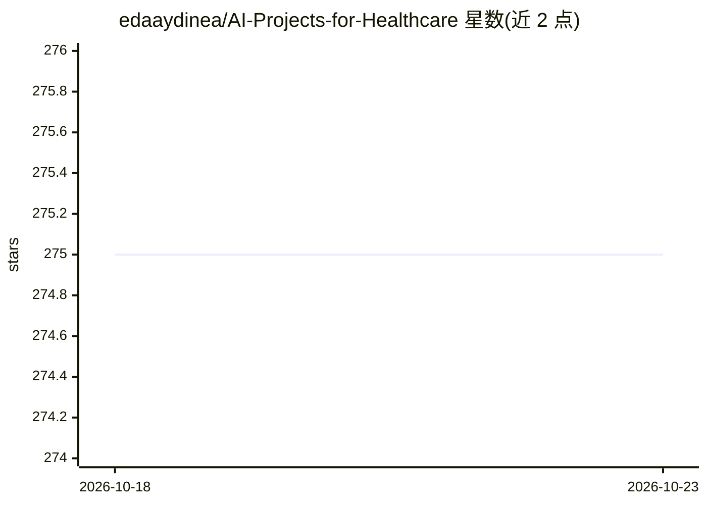

# edaaydinea/AI-Projects-for-Healthcare

⭐ 275 · Jupyter Notebook · Apache-2.0 · 推送 2026-04-05 · [GitHub](https://github.com/edaaydinea/AI-Projects-for-Healthcare) · 个人维护

**医疗健康领域 AI/ML 项目合集：教学与研究实现策展**

个人维护的医疗健康 AI 项目集合，收录经典机器学习、深度学习、计算机视觉与数据科学项目：涵盖乳腺癌/心脏病/糖尿病分类、胸片肺炎与 COVID-19 检测、阿尔茨海默病进展预测、胶质瘤 MRI 分割、认知阅读状态的 NLP 区分等。项目按训练营教学、AI 教学与研究三类组织，用完成度标记（完成/进行中/未完成）标注状态；研究类项目存放于独立仓库。数据集多来自 Kaggle、UCI、ZuCo 等公开来源。

## 筛选速览

| 维度 | 判定 | 备注 |
|---|---|---|
| AI 角色 | `ai-knowledge` | 知识聚合/清单类 |
| 许可风险 | `permissive` | Apache-2.0 |
| 部署形态 | `None` |  |
| 模型依赖 | — | README 未给出锁定关系 |
| 硬件要求 | — | 无带数字的原话,不猜 |
| 安装摩擦 | `low` | 无编译、无系统依赖或容器化 |
| 成熟度 | — | 结构信号不足 |

## 能力要点

- 覆盖医学影像、临床数据分析与认知神经科学的项目清单
- 按教学（bootcamp/AI 教育）与研究两类组织条目
- 每个项目标注完成度状态
- 研究项目附数据集来源说明（Kaggle/UCI/ZuCo 等）

## 适用场景

- 查找医疗健康领域的 AI 项目实例作为学习参考
- 了解医学影像分类与临床预测的常见实现路径
- 查找可复用的公开数据集项目线索

## 场景标签

`精选清单` · 领域:学习与行业

## 证据(README 行号)

> L3: This repository contains a curated collection of **Artificial Intelligence, Machine Learning, Data Science, and Comp
> L4: The projects range from educational implementations to applied research studies in medical imaging, clinical data an

## 星数曲线

2026-10-18 275 → 2026-10-23 275（+0）

---
*卡片 v1 · prompt 1.4 · 生成 2026-10-22 · 置信度 high · 依据 README sha `b0528eb74569` · [字段定义](../../DATASET.md)*
