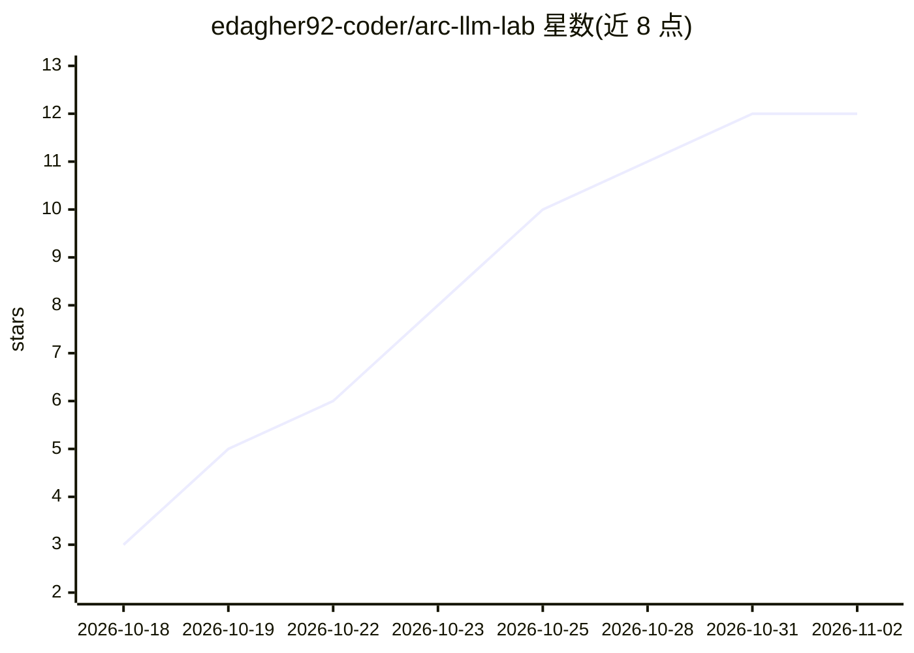

# edagher92-coder/arc-llm-lab

⭐ 12 · Python · MIT · 推送 2026-10-30 · [GitHub](https://github.com/edagher92-coder/arc-llm-lab) · [官网](https://edagher92-coder.github.io/arc-llm-lab/) · 个人维护

**Intel Arc 显卡上跑 Qwen 27B 的调优与评测栈：基准、调参、可靠性评估**

面向 Intel Arc（Pro B60 24GB 为主，兼容 B580/B570/A770 等）的本地 LLM 运行方案：在 llama.cpp Vulkan 基础上引入 vendored Intel flash-attention prefill 补丁与 DFlash2 投机解码，报告 Qwen3.8-27B 平均 53 tok/s 单请求解码、32K 上下文 420 tok/s prefill、64K 上下文窗口，全部数字附原始日志。附带 100 任务带隐藏校验的 agent 评测 harness、按剩余 VRAM 调整上下文的 governor、手机 Studio/工具网关、ComfyUI 本地视频生成与 Claude Code 桥接（ask_local）。仅 B60 有实测，其他卡为估算；所有数据为单机单次运行。Windows 用 PowerShell 脚本构建引擎，Linux 提供未完整验证的构建脚本。

## 筛选速览

| 维度 | 判定 | 备注 |
|---|---|---|
| AI 角色 | `ai-ecosystem` | LLM/agent 周边工具 |
| 许可风险 | `permissive` | MIT |
| 部署形态 | `None` |  |
| 模型依赖 | local-ok | 支持本地模型 |
| 硬件要求 | `gpu-24g` | |
| 安装摩擦 | `medium` | 含编译或系统依赖之一 |
| 成熟度 | — | 结构信号不足 |

## 能力要点

- llama.cpp Vulkan + Intel FA prefill 补丁 + DFlash2 投机解码的引擎构建与逐项调参日志
- 100 任务隐藏校验 agent 评测 harness（Claude Code 97/100，Codex 95/100，单次运行）
- 按剩余 VRAM 自动调整上下文窗口、保护活动会话的 governor
- 附带手机 Studio/工具网关与 LTX-2.5 本地视频生成（ComfyUI on XPU）

## 适用场景

- 在 Intel Arc B60 上运行本地编码模型并复现调优数字
- 用 benchmark 脚本测量自己的 Arc 卡并贡献数据
- 让 Claude Code/Codex 把低风险草稿交给本地模型处理
- 在一块 Arc 卡上同时管理 LLM、视频生成等 AI 工作负载

## 场景标签

`模型评测` `推理引擎` `视频生成` · 领域:评测与运维

## 证据(README 行号)

> L5: **The fastest single-card Qwen3.8-27B decode we have found published for the Intel Arc Pro B60 24GB (comparison): 53
> L78: This is a full local-AI stack, not a config gist: a portable engine build with vendored kernel patches (engine/), a
> L82: 1. **Build the engine** (Windows 11, portable, no admin): `powershell -ExecutionPolicy Bypass -File engine\build.ps

## 星数曲线

2026-10-18 3 → 2026-11-02 12（+9）

---
*卡片 v1 · prompt 1.4 · 生成 2026-11-01 · 置信度 high · 依据 README sha `f96af88fa46a` · [字段定义](../../DATASET.md)*
