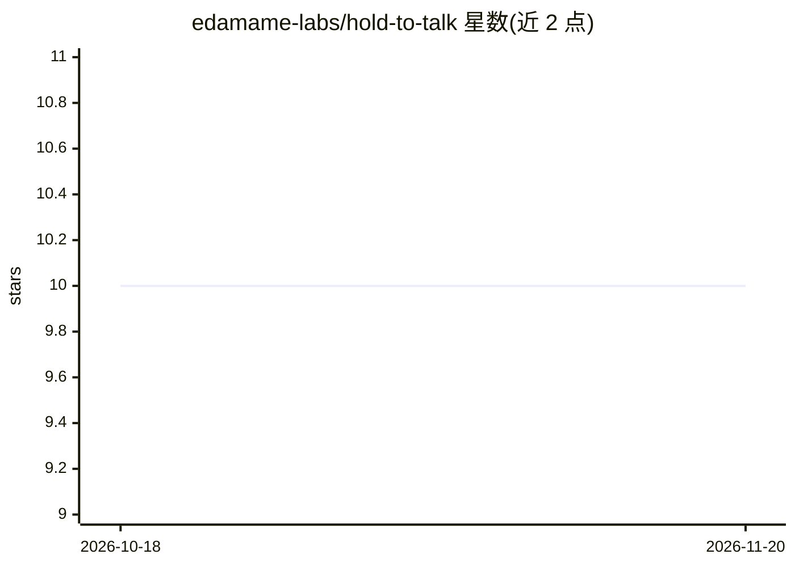

# edamame-labs/hold-to-talk

⭐ 10 · Swift · Apache-2.0 · 推送 2026-08-21 · [GitHub](https://github.com/edamame-labs/hold-to-talk) · [官网](https://holdtotalk.ai/) · 组织维护

**macOS 本地语音听写工具：按键说话松开即输入文字**

面向 Apple Silicon Mac 的开源听写应用：按住快捷键录音，松开后经语音识别将文字粘贴到任意应用的光标处。默认本地运行，使用 sherpa-onnx 推理 NVIDIA Parakeet TDT 0.6B（int8 量化，约 640 MB），可选 OpenAI 兼容 API 做云端转写；文本清理可由本机 S1-mini、Apple Intelligence 或云端 OpenAI/Anthropic 完成。支持 Homebrew 与签名 DMG 安装，提供 MDM/PPPC 企业部署与无外网全本机模式。要求 macOS 15+ 与 Apple Silicon。

## 筛选速览

| 维度 | 判定 | 备注 |
|---|---|---|
| AI 角色 | `ai-native` | 本体是模型或模型工具 |
| 许可风险 | `permissive` | Apache-2.0 |
| 部署形态 | `None` |  |
| 模型依赖 | — | README 未给出锁定关系 |
| 硬件要求 | — | 无带数字的原话,不猜 |
| 安装摩擦 | `low` | 无编译、无系统依赖或容器化 |
| 成熟度 | — | 结构信号不足 |

## 能力要点

- 本地语音识别：sherpa-onnx + NVIDIA Parakeet TDT 0.6B（int8 量化）
- 可选云端转写与文本清理，使用用户自持 API key 直连服务商
- 按住快捷键录音、松开即插入文字，支持任意目标应用
- MDM 托管配置、PPPC 权限预批与 Azure OpenAI/代理路由的企业部署路径

## 适用场景

- 在 Slack、备忘录、IDE、邮件等任意应用中语音输入文字
- 无账号、无追踪需求下全程本地转写
- 企业通过 MDM 批量部署并统一管控云端流量

## 场景标签

`语音识别` · 领域:感知与多模态

## 证据(README 行号)

> L5:  Free, open-source voice dictation for Apple Silicon Macs. Hold a key, speak, release — your words appear wherever y
> L23: - **Apple Silicon required** — built around local speech recognition with sherpa-onnx + NVIDIA Parakeet TDT 0.6B, a

## 星数曲线

2026-10-18 10 → 2026-11-20 10（+0）

---
*卡片 v1 · prompt 1.4 · 生成 2026-11-19 · 置信度 high · 依据 README sha `bbd96f05b673` · [字段定义](../../DATASET.md)*
