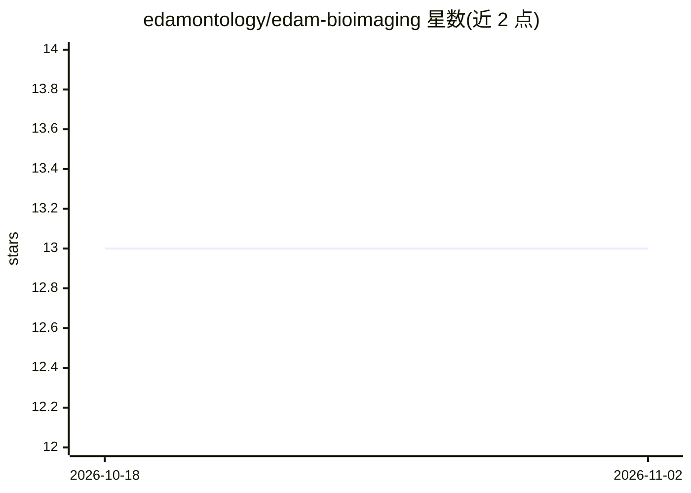

# edamontology/edam-bioimaging

⭐ 13 · Shell · CC-BY-SA-4.0 · 推送 2026-10-29 · [GitHub](https://github.com/edamontology/edam-bioimaging) · [官网](https://webprotege.stanford.edu/#projects/2ce704bf-83ed-4d2e-985f-84c4841fac71/edit/Classes) · 组织维护

**生物成像信息学领域的本体（ontology）扩展：成像/图像分析/数据格式的受控词表**

EDAM Bioimaging 是 EDAM 科学本体面向成像与生物图像信息学的扩展，覆盖成像技术、图像处理与分析操作、图像数据与格式，并涉及 AI/ML、质谱与细胞术相关概念。由全球开放社区（NEUBIAS/GloBIAS、COMULIS、ELIXIR、Euro-BioImaging 等联盟项目）协作开发，内容经 WebProtégé 在线协同编辑，以 OWL 格式发布，可在 NCBO BioPortal 与 WebVOWL 查看。仓库声明自身处于 WIP 阶段且与 WebProtégé 开发分支不同步，最新版本需访问 BioPortal 或官网 OWL 文件。

## 筛选速览

| 维度 | 判定 | 备注 |
|---|---|---|
| AI 角色 | `ai-knowledge` | 知识聚合/清单类 |
| 许可风险 | `viral` | CC-BY-SA-4.0 |
| 部署形态 | `None` |  |
| 模型依赖 | — | README 未给出锁定关系 |
| 硬件要求 | — | 无带数字的原话,不猜 |
| 安装摩擦 | `low` | 无编译、无系统依赖或容器化 |
| 成熟度 | `idea` | |

## 能力要点

- EDAM 本体在成像/生物图像信息学方向的扩展
- 覆盖成像技术、图像处理分析操作、图像数据与格式概念
- 全球多联盟/项目社区协作，经 WebProtégé 协同编辑
- 提供 OWL 格式下载与 WebVOWL 可视化查看

## 适用场景

- 为生物图像分析工具与工作流标注标准化的操作/主题/数据类型概念
- 在数据管理系统或软件目录中按 EDAM Bioimaging 术语做分类检索
- 科研应用中复用受控词表描述图像分析方法与数据格式

## 场景标签

 · 领域:生命科学/知识工程

## 证据(README 行号)

> L9: **An ontology of imaging and related techniques and technologies, image processing and analysis, image data and form
> L11: EDAM Bioimaging is an extension to the EDAM ontology (http://edamontology.org), dedicated to imaging and (bio)image

## 星数曲线

2026-10-18 13 → 2026-11-02 13（+0）

---
*卡片 v1 · prompt 1.4 · 生成 2026-10-31 · 置信度 high · 依据 README sha `6e604d77777d` · [字段定义](../../DATASET.md)*
