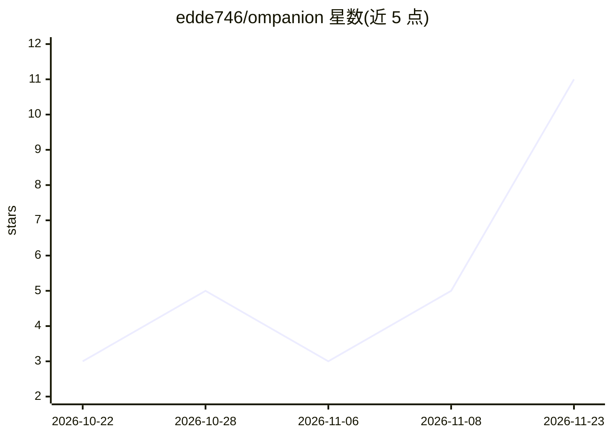

# edde746/ompanion

⭐ 11 · TypeScript · GPL-3.0 · 推送 2026-11-16 · [GitHub](https://github.com/edde746/ompanion) · [官网](https://ompanion.app) · 个人维护

**omp 编码 agent 的跨平台 GUI 客户端，支持本地与 SSH/Tailscale 远程**

为 oh-my-pi（omp）编码 agent 提供图形客户端，覆盖本机与经 SSH、跳板链、Tailscale 连接的远程机器，主机上无需守护进程。提供流式会话转录、工具调用卡片与内联审批、会话树与分支、多设备同会话、目标/循环模式，以及 Agent Hub、文件面板与终端标签。覆盖 macOS、Windows、Linux、iOS、Android 五平台，同一 Web UI 配 Go 核心；远程会话脱离设备继续运行，推送通知经中继端到端加密。构建需 Bun、Go 及各平台工具链。

## 筛选速览

| 维度 | 判定 | 备注 |
|---|---|---|
| AI 角色 | `ai-ecosystem` | LLM/agent 周边工具 |
| 许可风险 | `viral` | GPL-3.0 |
| 部署形态 | `desktop` | 安装包/桌面程序 |
| 模型依赖 | — | README 未给出锁定关系 |
| 硬件要求 | — | 无带数字的原话,不猜 |
| 安装摩擦 | `medium` | 含编译或系统依赖之一 |
| 成熟度 | — | 结构信号不足 |

## 能力要点

- 无需守护进程：经 SSH/跳板/Tailscale 运行远端 omp，会话脱离设备继续执行
- 工具卡片与内联审批、Agent Hub 子代理管理、会话树与分支
- iOS/Android 推送通知经中继端到端加密
- 一套代码覆盖 macOS/Windows/Linux/iOS/Android，Web UI + Go 核心

## 适用场景

- 在手机上查看并继续电脑上运行的编码 agent 会话
- 通过 SSH/Tailscale 管理多台机器上的 omp 会话
- 为子代理、目标与循环任务集中监控 token 与成本

## 场景标签

`编码 Agent` · 领域:编码与开发

## 证据(README 行号)

> L4: A GUI client for omp, the oh-my-pi coding agent, on this computer and on remote machines over SSH, jump hosts and Ta
> L54: - Tool cards for bash, read, edit and write with word-level diffs, eval, todo, task subagents, web search and fetch
> L111: - One codebase for macOS, Windows, Linux, iOS and Android: a web UI in each platform's own webview, on a Go core

## 星数曲线

2026-10-22 3 → 2026-11-23 11（+8）

---
*卡片 v1 · prompt 1.4 · 生成 2026-11-23 · 置信度 high · 依据 README sha `5f3b58f0dbdf` · [字段定义](../../DATASET.md)*
