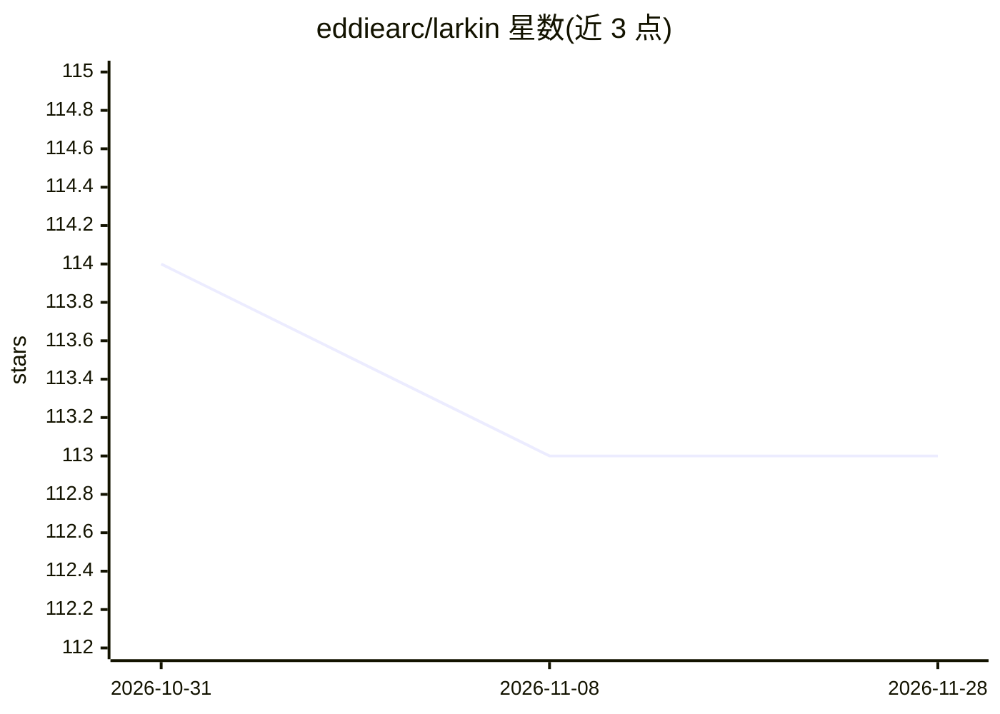

# eddiearc/larkin

⭐ 113 · TypeScript · Apache-2.0 · 推送 2026-11-27 · [GitHub](https://github.com/eddiearc/larkin) · [官网](https://idanlin.cc/work/larkin/) · 个人维护 · 中文 README

**把本地 Codex/Claude Code 等 Coding Agent 接入飞书的本地运行时宿主**

Larkin 是一个本地 Runtime Host 进程，将外部安装的五种 Coding Agent 运行时（Pi、Codex、Claude Code、Cursor CLI、Antigravity CLI）连接到飞书/Lark，提供会话与提醒的持久化、消息与交互卡片处理、内嵌 Dashboard 与 OpenTelemetry 追踪。自身不携带 Agent 运行时，也不存储 Provider 凭证；要求各运行时先自行安装并登录。支持 macOS/Linux/Windows x64，经 npm 分发或提供独立二进制。

## 筛选速览

| 维度 | 判定 | 备注 |
|---|---|---|
| AI 角色 | `ai-ecosystem` | LLM/agent 周边工具 |
| 许可风险 | `permissive` | Apache-2.0 |
| 部署形态 | `desktop` | 安装包/桌面程序 |
| 模型依赖 | — | README 未给出锁定关系 |
| 硬件要求 | — | 无带数字的原话,不猜 |
| 安装摩擦 | `low` | 无编译、无系统依赖或容器化 |
| 成熟度 | — | 结构信号不足 |

## 能力要点

- 单一本地进程接入五种外部 Coding Agent 运行时
- 持久化会话与提醒，跨运行可用
- 内嵌 Dashboard 与 OpenTelemetry 本地追踪及离线导出/导入
- 支持飞书消息、交互卡片与可配置的 Inbox 巡检

## 适用场景

- 在飞书群或私聊中与本地 Coding Agent 会话
- 为团队把 Agent 会话、提醒固定在本机管理
- 通过 Dashboard 与追踪链路查看消息处理时序

## 场景标签

`编码 Agent` · 领域:编码与开发

## 证据(README 行号)

> L1: Larkin connecting Codex, Claude Code, and Pi agent runtimes to Feishu with a local dashboard and message surfaces.
> L5: Larkin is a local Runtime Host that connects Codex, Claude Code, Pi, Cursor CLI, and Antigravity CLI agent runtimes 
> L69: During setup, choose one of the five externally installed runtimes: Pi (`pi`), Codex (`codex`), Claude Code (`claud

## 星数曲线

2026-10-31 114 → 2026-11-28 113（-1）

---
*卡片 v1 · prompt 1.4 · 生成 2026-11-28 · 置信度 mid · 依据 README sha `11497fa286d3` · [字段定义](../../DATASET.md)*
