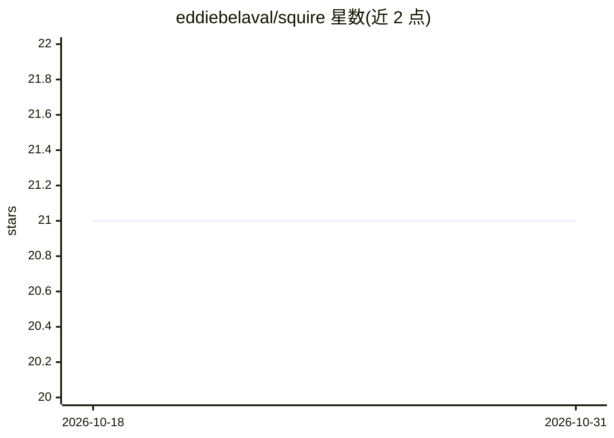

# eddiebelaval/squire

⭐ 21 · Python · MIT · 推送 2026-08-16 · [GitHub](https://github.com/eddiebelaval/squire) · [官网](https://id8labs.app) · 个人维护

**给 AI 编程用户的 Claude Code 行为规则与命令工具包**

一套投入项目或全局配置的规则、模板与工具集合，用于改变 AI 编程代理的行为：含 1 份旗舰行为规则文件 squire.md、80 个 Claude Code 斜杠命令（/ship、/deploy 等）、348 个按领域组织的技能、35 个自定义 agent、11 阶段 stage-gate 构建流水线、Director/Builder 双模型编排模式，以及 VISION/SPEC/BUILDING 三文档体系。作者称内容提炼自 104 个仓库的日常 AI 辅助开发实践。通过 curl 单文件、git clone 运行 install.sh 或按需复制文件三种方式安装。

## 筛选速览

| 维度 | 判定 | 备注 |
|---|---|---|
| AI 角色 | `ai-ecosystem` | LLM/agent 周边工具 |
| 许可风险 | `permissive` | MIT |
| 部署形态 | `None` |  |
| 模型依赖 | — | README 未给出锁定关系 |
| 硬件要求 | — | 无带数字的原话,不猜 |
| 安装摩擦 | `low` | 无编译、无系统依赖或容器化 |
| 成熟度 | — | 结构信号不足 |

## 能力要点

- 348 个技能按前端、后端、营销、财务等 17+ 类组织
- 80 个 Claude Code 斜杠命令覆盖开发、架构、运营等流程
- Director/Builder 双模型编排模式，含失败阈值机制
- VISION/SPEC/BUILDING 三文档自校正产品文档体系

## 适用场景

- 让 Claude Code 等编程代理按行为规则执行开发流程
- 通过斜杠命令调用 /ship、/deploy 等完整交付流水线
- 为项目建立 VISION/SPEC/BUILDING 活文档并检测漂移

## 场景标签

`提示工程` · 领域:Agent 开发

## 证据(README 行号)

> L9: Squire is a collection of rules, patterns, templates, and tools that make AI coding agents (Claude Code, Cursor, Cop
> L11: It's not a product. It's an operating system -- a set of files you drop into your project or your global config tha

## 星数曲线

2026-10-18 21 → 2026-10-31 21（+0）

---
*卡片 v1 · prompt 1.4 · 生成 2026-10-28 · 置信度 high · 依据 README sha `47fa91fa73a1` · [字段定义](../../DATASET.md)*
