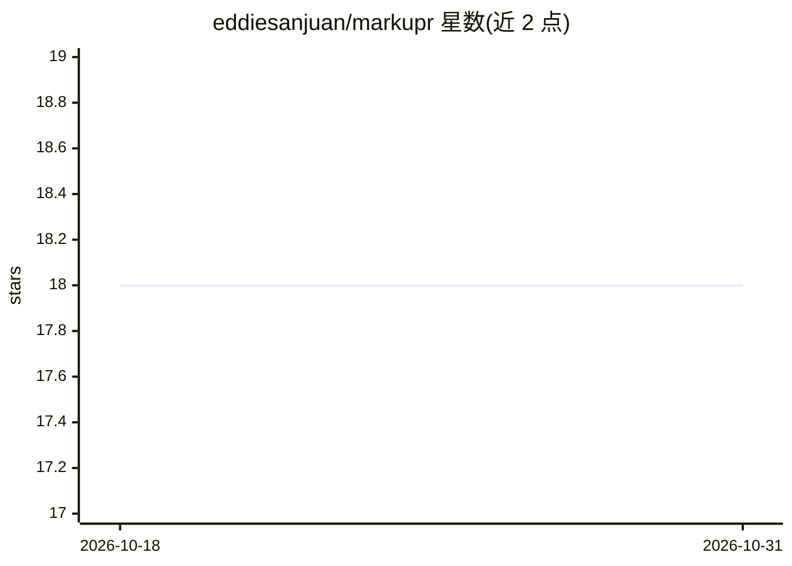

# eddiesanjuan/markupr

⭐ 18 · TypeScript · MIT · 推送 2026-05-01 · [GitHub](https://github.com/eddiesanjuan/markupr) · [官网](https://markupr.com/) · 个人维护

**录屏+口述转结构化 Markdown 的桌面工具，供 AI 编码代理消费**

面向使用 AI 编码代理的开发者的桌面捕获应用：按热键录屏并口述问题，管线用 Whisper 在本地转录、ffmpeg 按时间戳抽取帧，附带光标位置、活动窗口、焦点提示等上下文，生成面向 LLM 的结构化 Markdown 报告。同一管线提供四种接口：桌面应用（默认）、CLI（analyze/watch/push，可建 GitHub/Linear issue）、MCP 服务器（截图、录音、视频分析等 6 个工具）与 GitHub Action。本地运行，无需 API key，管线在缺少 ffmpeg 或 Whisper 时降级。

## 筛选速览

| 维度 | 判定 | 备注 |
|---|---|---|
| AI 角色 | `ai-ecosystem` | LLM/agent 周边工具 |
| 许可风险 | `permissive` | MIT |
| 部署形态 | `library` | 以包/库形式分发 |
| 模型依赖 | — | README 未给出锁定关系 |
| 硬件要求 | — | 无带数字的原话,不猜 |
| 安装摩擦 | `medium` | 含编译或系统依赖之一 |
| 成熟度 | — | 结构信号不足 |

## 能力要点

- Whisper 本地转录 + ffmpeg 按时间戳抽帧，输出结构化 Markdown
- MCP 服务器提供 capture_screenshot / capture_with_voice / analyze_video 等 6 个工具
- CLI 支持输出 markdown/json/github-issue/linear/jira/html 模板并推送建 issue
- 无 ffmpeg/无 Whisper 模型/无 API key 时管线降级运行

## 适用场景

- 发现 UI bug 时录屏口述，把报告粘给 Claude Code/Cursor 等代理修复
- 让 AI 代理通过 MCP 会话内直接截图、录音获取上下文
- CI 中用 GitHub Action 对 PR 录像生成视觉反馈报告

## 场景标签

`语音识别` `图像视频处理` · 领域:感知与多模态

## 证据(README 行号)

> L103: Give your AI coding agent eyes and ears. Add markupR as an MCP server and it can capture screenshots, record your 
> L116: **Cursor / Windsurf** -- same config in your MCP settings.

## 星数曲线

2026-10-18 18 → 2026-10-31 18（+0）

---
*卡片 v1 · prompt 1.4 · 生成 2026-10-29 · 置信度 high · 依据 README sha `916ffcd02f15` · [字段定义](../../DATASET.md)*
