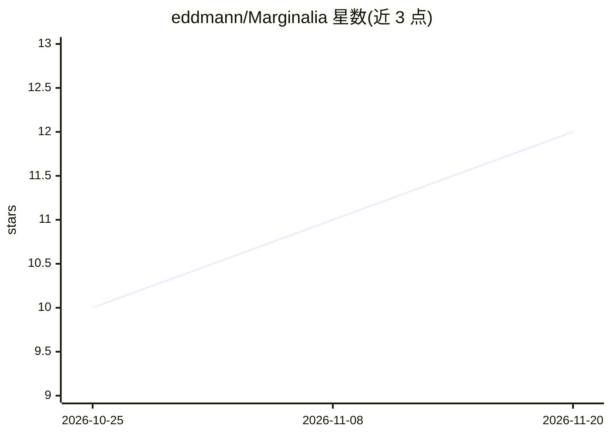

# eddmann/Marginalia

⭐ 12 · TypeScript · AGPL-3.0 · 推送 2026-03-25 · [GitHub](https://github.com/eddmann/Marginalia) · 个人维护

**给读书人的桌面电子书阅读器：划选即可与 AI 对话**

基于 Tauri 的桌面阅读器，由 Readest 阅读器的精简分支与 Pi agent 框架组合而成，支持 EPUB、PDF、MOBI、AZW3、CBZ 等 8 种格式，提供高亮、书签、批注导出 Markdown、全文检索与版式自定义。AI 侧以侧边栏形式提供对话：选中文本后点击 "Ask AI" 提问，应用将整章文本作为上下文，支持每本书多会话并跨会话持久化，并提供书外网络检索。凭据复用本机 Claude Code 与 Codex CLI 的登录态，无需单独配置 API key。分发渠道为 Homebrew 与 GitHub Releases，macOS 与 Linux 提供安装包。

## 筛选速览

| 维度 | 判定 | 备注 |
|---|---|---|
| AI 角色 | `ai-enhanced` | 去掉 AI 部分产品仍成立 |
| 许可风险 | `viral` | AGPL-3.0 |
| 部署形态 | `desktop` | 安装包/桌面程序 |
| 模型依赖 | — | README 未给出锁定关系 |
| 硬件要求 | — | 无带数字的原话,不猜 |
| 安装摩擦 | `medium` | 含编译或系统依赖之一 |
| 成熟度 | — | 结构信号不足 |

## 能力要点

- 选中文本提问，整章文本作为对话上下文
- 每本书支持多个会话并跨会话持久化
- 复用 Claude Code / Codex CLI 登录凭据，无需单独 API key
- 支持 EPUB/PDF/MOBI/AZW3/FB2/CBZ/TXT/Markdown 八种格式

## 适用场景

- 阅读技术书籍时对选中的段落或代码片段提问
- 边阅读边进行持续的章节讨论并保留批注
- 在阅读器内结合网络检索补充书外背景知识

## 场景标签

`文档问答` `AI 助手` · 领域:对话与助手

## 证据(README 行号)

> L5: A desktop ebook reader with a built-in AI companion.
> L18: Marginalia combines a slimmed-down fork of Readest (an open-source ebook reader) with Pi (an AI agent framework) in
> L24: - EPUB, PDF, MOBI, AZW/AZW3, FB2, CBZ, TXT, Markdown

## 星数曲线

2026-10-25 10 → 2026-11-20 12（+2）

---
*卡片 v1 · prompt 1.4 · 生成 2026-11-18 · 置信度 high · 依据 README sha `41b76614a38b` · [字段定义](../../DATASET.md)*
