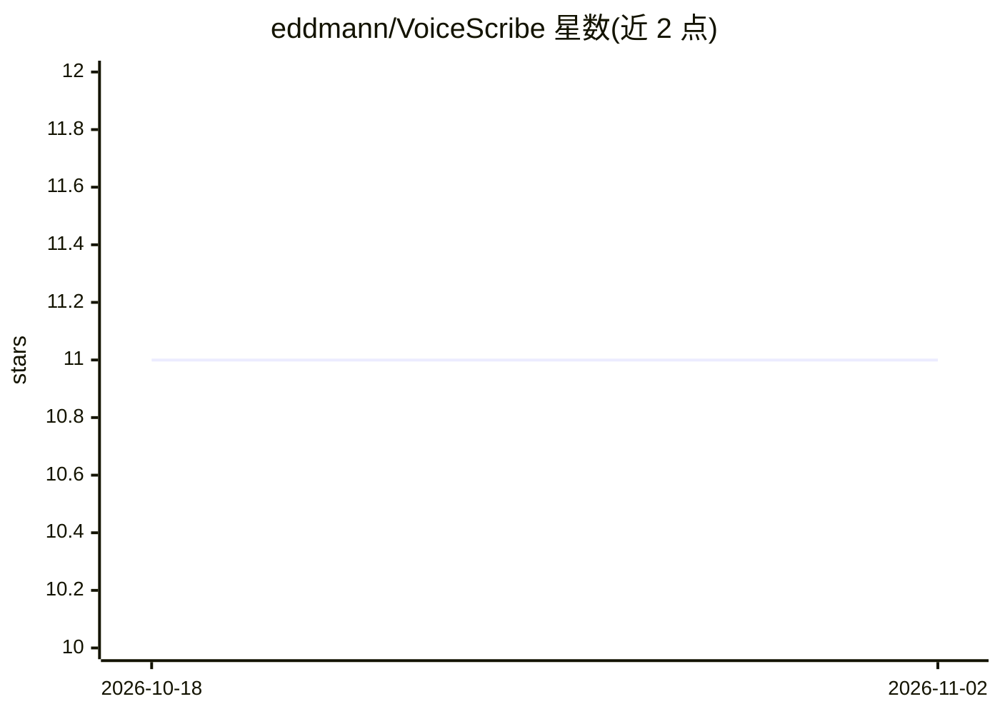

# eddmann/VoiceScribe

⭐ 11 · Swift · MIT · 推送 2026-04-27 · [GitHub](https://github.com/eddmann/VoiceScribe) · [官网](https://eddmann.com/VoiceScribe/) · 个人维护

**macOS 菜单栏本地听写应用：全局热键录音转文字**

运行于 macOS 菜单栏的本地听写应用：通过全局热键 Option-Shift-Space 录音，调用 WhisperKit（Whisper 系列模型）或 FluidAudio（Parakeet 系列模型）在设备端完成转录，可选启用基于 MLX 的本地 LLM（Qwen3 1.7B/4B、Llama 3.2 3B）做标点与格式清理，最后复制或自动粘贴回当前应用。历史记录同时保存原文与处理后版本。首次使用需联网下载模型，之后全程离线，无云端路径、无 API key。要求 macOS 14.0+ 与 Apple Silicon，提供 Homebrew 安装与签名公证的下载包。

## 筛选速览

| 维度 | 判定 | 备注 |
|---|---|---|
| AI 角色 | `ai-native` | 本体是模型或模型工具 |
| 许可风险 | `permissive` | MIT |
| 部署形态 | `None` |  |
| 模型依赖 | — | README 未给出锁定关系 |
| 硬件要求 | — | 无带数字的原话,不猜 |
| 安装摩擦 | `low` | 无编译、无系统依赖或容器化 |
| 成熟度 | — | 结构信号不足 |

## 能力要点

- Whisper（Small/Distil Large v3/Large v3）与 Parakeet（English v2/Multilingual v3）双转录引擎
- 可选 MLX 本地 LLM 清理（Qwen3 1.7B/4B、Llama 3.2 3B）
- 全局热key录音后复制或自动粘贴回当前应用
- 本地-only：无云端转录、无 API key、无遥测

## 适用场景

- 在任意 macOS 应用中用语音快速输入文字
- 对听写文稿做本地标点与格式整理
- 离线环境下保护语音与文本隐私的听写

## 场景标签

`语音识别` · 领域:感知与多模态

## 证据(README 行号)

> L9: VoiceScribe is a local macOS dictation app that lives in the menu bar. Use a global hotkey, speak, and it returns te
> L14: 2. Transcribe with Whisper or Parakeet
> L22: - Local transcription with Whisper or Parakeet

## 星数曲线

2026-10-18 11 → 2026-11-02 11（+0）

---
*卡片 v1 · prompt 1.4 · 生成 2026-11-02 · 置信度 high · 依据 README sha `93804296788f` · [字段定义](../../DATASET.md)*
