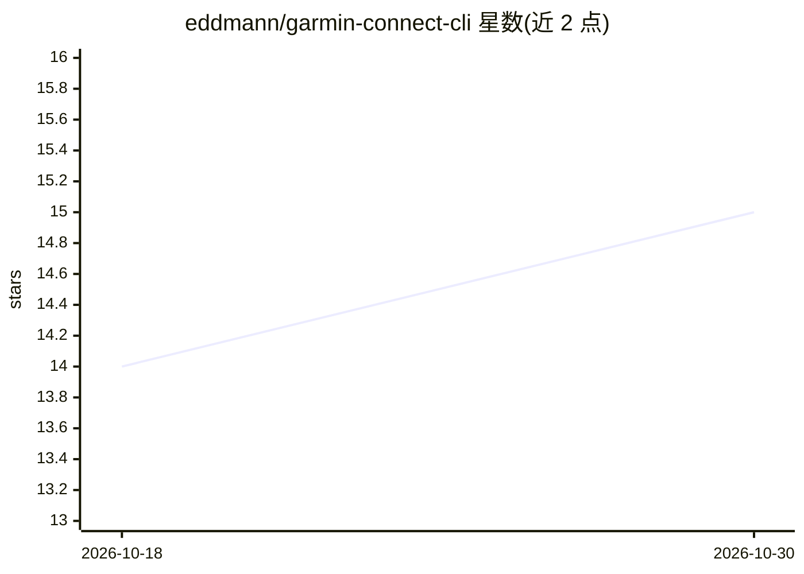

# eddmann/garmin-connect-cli

⭐ 15 · Python · MIT · 推送 2026-05-20 · [GitHub](https://github.com/eddmann/garmin-connect-cli) · [官网](https://eddmann.com/garmin-connect-cli/) · 个人维护

**命令行访问 Garmin Connect 健康运动数据，可作为 AI agent 技能**

用 Python 编写的终端 CLI，通过 python-garminconnect 访问 Garmin Connect：列出/下载/上传/删除活动，读取睡眠、心率、压力、身体电量、HRV、VO2max 等健康与训练指标，支持多配置文件与 MFA 登录，令牌本地存储约一年有效。输出 JSON/JSONL/CSV/TSV/表格格式，可配合 jq 与 Unix 管道组合；另提供面向 LLM 的聚合 context 命令，并可安装为 Claude Code、Cursor 等 agent 的技能（SKILL.md）。macOS/Linux 提供预编译二进制安装脚本，另支持 Homebrew、uv/PyPI 与源码安装。

## 筛选速览

| 维度 | 判定 | 备注 |
|---|---|---|
| AI 角色 | `ai-enhanced` | 去掉 AI 部分产品仍成立 |
| 许可风险 | `permissive` | MIT |
| 部署形态 | `library` | 以包/库形式分发 |
| 模型依赖 | — | README 未给出锁定关系 |
| 硬件要求 | — | 无带数字的原话,不猜 |
| 安装摩擦 | `low` | 无编译、无系统依赖或容器化 |
| 成熟度 | — | 结构信号不足 |

## 能力要点

- 覆盖活动、健康、训练、体重四大类 Garmin 数据的完整命令集
- JSON/JSONL/CSV/TSV/human 多格式输出，可配合 jq 与 Unix 管道组合
- 面向 LLM 的 context 聚合命令与 AI agent 技能安装脚本
- 多 profile、MFA 支持与本地令牌管理

## 适用场景

- 在终端查询自己的运动与健康数据并导出分析
- 用脚本/管道自动化处理 Garmin 数据（如筛选超过 10km 的跑步）
- 让 Claude Code 或 Cursor 等 agent 通过技能直接读取我的健身数据

## 场景标签

 · 领域:健康/运动数据工具

## 证据(README 行号)

> L14: - All your Garmin data — activities, stats, sleep, heart rate, stress, body battery
> L158: This CLI is available as an Agent Skill — it works with Claude Code, Cursor, and other compatible AI agents. See `

## 星数曲线

2026-10-18 14 → 2026-10-30 15（+1）

---
*卡片 v1 · prompt 1.4 · 生成 2026-10-30 · 置信度 high · 依据 README sha `beff447d2421` · [字段定义](../../DATASET.md)*
