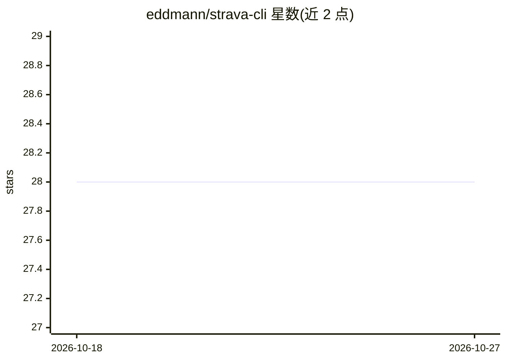

# eddmann/strava-cli

⭐ 28 · Python · MIT · 推送 2026-05-22 · [GitHub](https://github.com/eddmann/strava-cli) · [官网](https://eddmann.com/strava-cli/) · 个人维护

**面向终端与 AI agent 的 Strava 数据命令行工具**

Python 编写的 Strava API CLI：覆盖活动、统计、路段、路线、俱乐部、装备的读取与活动创建/上传，OAuth 认证，输出 JSON/JSONL/CSV/TSV/表格格式，可配合 jq 与 Unix 管道组合脚本。作者将其同时定位为 AI agent 技能（Agent Skills 标准），提供脚本安装到 Claude Code 与 Cursor 的技能目录，并有 strava context 命令输出汇总上下文供 LLM 使用。提供 install.sh 预编译二进制、Homebrew、uv/PyPI（strava-terminal）与源码安装方式。需要 Python 3.10+，依赖 stravalib。

## 筛选速览

| 维度 | 判定 | 备注 |
|---|---|---|
| AI 角色 | `ai-ecosystem` | LLM/agent 周边工具 |
| 许可风险 | `permissive` | MIT |
| 部署形态 | `library` | 以包/库形式分发 |
| 模型依赖 | — | README 未给出锁定关系 |
| 硬件要求 | — | 无带数字的原话,不猜 |
| 安装摩擦 | `low` | 无编译、无系统依赖或容器化 |
| 成熟度 | `idea` | |

## 能力要点

- Strava 活动统计/路线导出（GPX/TCX）等数据访问与活动上传的完整命令集
- JSON/JSONL/CSV/TSV/表格多格式输出，兼容 jq 与 Unix 管道组合
- 以 Agent Skill 形式接入 Claude Code、Cursor 等 AI agent，附 strava context 上下文命令
- 提供 install.sh 预编译二进制、Homebrew、uv/PyPI 多种安装方式

## 适用场景

- 在终端查看和管理我的 Strava 骑行/跑步数据
- 用管道和 jq 脚本化处理运动活动数据
- 让 Claude Code 等 AI agent 代为查询和操作我的 Strava 数据

## 场景标签

 · 领域:运动健身数据/开发工具

## 证据(README 行号)

> L16: - AI agent ready — install the skill for Claude, Cursor, and other assistants
> L215: This CLI is available as an Agent Skill — it works with Claude Code, Cursor, and other compatible AI agents. See `
> L241: This project is an exploration of Claude Code Skills and the emerging Agent Skills standard for AI-tool interopera

## 星数曲线

2026-10-18 28 → 2026-10-27 28（+0）

---
*卡片 v1 · prompt 1.4 · 生成 2026-10-26 · 置信度 high · 依据 README sha `7c889020fec9` · [字段定义](../../DATASET.md)*
