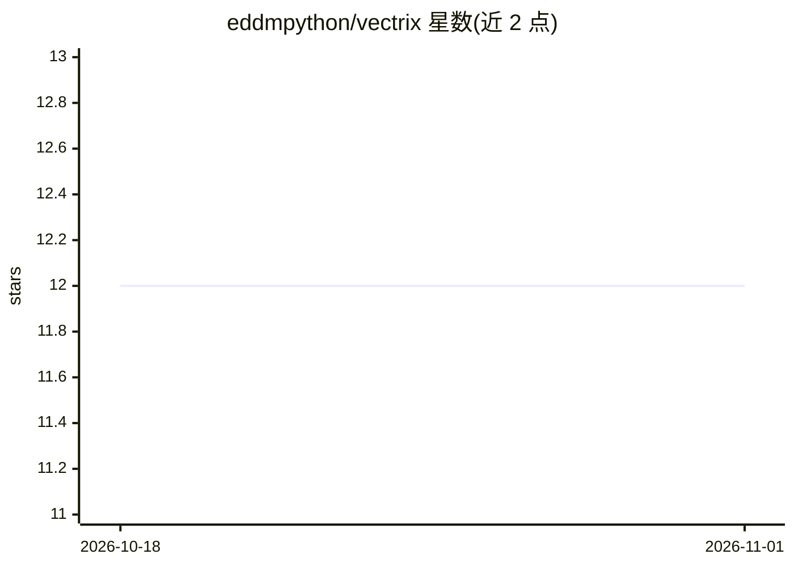

# eddmpython/vectrix

⭐ 12 · Python · MIT · 推送 2026-10-20 · [GitHub](https://github.com/eddmpython/vectrix) · [官网](https://eddmpython.github.io/vectrix/) · 个人维护

**零配置 Python 时间序列预测库：自动选模型并输出预测**

面向需要时间序列预测的开发者的 Python 库：forecast() 一行代码运行 ETS/ARIMA/Theta/TBATS 等 30+ 模型，交叉验证后返回最优预测与置信区间。核心机制包括 Forecast DNA（65+ 统计特征画像驱动模型推荐）、平坦预测检测校正、HMM 状态切换检测与共形预测自校准、8 类业务约束和层级调和；内置 Rust 加速引擎随 wheel 预编译，无需编译器，仅依赖 NumPy/SciPy/Pandas。另含 R 风格回归诊断、Plotly 可视化与自包含 HTML 仪表板（可选依赖）。M4 竞赛数据基准结果见 README。

## 筛选速览

| 维度 | 判定 | 备注 |
|---|---|---|
| AI 角色 | `ai-native` | 本体是模型或模型工具 |
| 许可风险 | `permissive` | MIT |
| 部署形态 | `library` | 以包/库形式分发 |
| 模型依赖 | — | README 未给出锁定关系 |
| 硬件要求 | — | 无带数字的原话,不猜 |
| 安装摩擦 | `low` | 无编译、无系统依赖或容器化 |
| 成熟度 | — | 结构信号不足 |

## 能力要点

- 30+ 预测模型自动选择，含交叉验证与置信区间
- Forecast DNA：65+ 统计特征画像驱动模型推荐
- Rust 引擎预编译进 wheel，仅 3 个依赖（NumPy/SciPy/Pandas）
- R 风格公式回归（OLS/Ridge/Lasso/Huber/Quantile）与完整诊断

## 适用场景

- 用一行代码对销售、库存等时间序列做自动预测
- 分析数据的趋势、季节性、变点与异常
- 对层级时间序列做调和并在预测上施加业务约束
- 生成含模型对比与预测图的自包含 HTML 报告

## 场景标签

 · 领域:时间序列预测/数据科学

## 证据(README 行号)

> L27: Vectrix is a time series forecasting engine that **understands your data before predicting it**. Every series is pr
> L33: Pass a list, DataFrame, or CSV path to `forecast()`. Vectrix runs multiple models (ETS, ARIMA, Theta, TBATS, CES, M
> L37: result = forecast("sales.csv", steps=12)

## 星数曲线

2026-10-18 12 → 2026-11-01 12（+0）

---
*卡片 v1 · prompt 1.4 · 生成 2026-11-01 · 置信度 high · 依据 README sha `c4e45c26a67b` · [字段定义](../../DATASET.md)*
