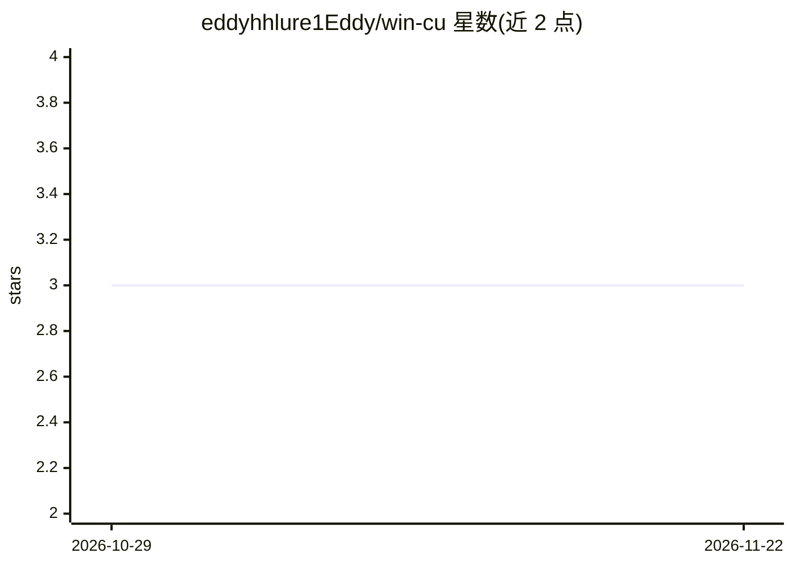

# eddyhhlure1Eddy/win-cu

⭐ 3 · Python · MIT · 推送 2026-10-27 · [GitHub](https://github.com/eddyhhlure1Eddy/win-cu) · 个人维护

**让 AI agent 通过 MCP 操控 Windows PC 的服务器**

以 Python 编写的 MCP server（stdio 传输，版本 2.0.0），供接入 MCP 的 AI agent 操控 Windows 电脑：截图、鼠标键盘输入、剪贴板、窗口与应用控制、UI Automation 无障碍树读取，使用 SendInput 与 PrintWindow 实现。提供 computer_batch 批量动作、双坐标系（桌面/窗口）、100 秒超时等机制，并内置安全拒绝规则：终端、安全登录、密码管理器等窗口禁入，用户操作时让路，多会话互斥。要求 Windows 11 与 Python 3.13，通过 pip 安装并在 Claude Code 中注册。

## 筛选速览

| 维度 | 判定 | 备注 |
|---|---|---|
| AI 角色 | `ai-ecosystem` | LLM/agent 周边工具 |
| 许可风险 | `permissive` | MIT |
| 部署形态 | `desktop` | 安装包/桌面程序 |
| 模型依赖 | — | README 未给出锁定关系 |
| 硬件要求 | — | 无带数字的原话,不猜 |
| 安装摩擦 | `low` | 无编译、无系统依赖或容器化 |
| 成熟度 | — | 结构信号不足 |

## 能力要点

- 通过 MCP 提供 30 余个工具：截图、鼠标、键盘、剪贴板、窗口与应用控制、无障碍树
- computer_batch 最多按序执行 30 步、75 秒内失败即停并以截图收尾
- 安全机制：禁入窗口清单、代码编辑器仅只读、Esc 暂停输入、用户操作时让路
- 随附 Claude Code skill（SKILL.md）与单元/工具/e2e 测试脚本

## 适用场景

- 让 Claude Code 等 agent 代为操作 Windows 桌面完成 GUI 任务
- 通过无障碍树元素名点击控件而非依赖像素坐标
- 为 computer use 能力搭建自动化回归测试（e2e_session.py）

## 场景标签

`GUI 自动化` `编码 Agent` · 领域:效率与自动化

## 证据(README 行号)

> L15: An MCP server that lets an AI agent operate a Windows PC: screenshots, mouse, keyboard, clipboard, windows and UI A
> L9: It supports all AI models. Most of the testing was done by Anthropic's advanced models, but ChatGPT 6 and Chinese mo
> L50: - `mcp>=1.23,<2`, `comtypes>=1.4`, `pillow>=10` (tested with mcp 1.23.1, comtypes 1.4.16, pillow 12.3.0)

## 星数曲线

2026-10-29 3 → 2026-11-22 3（+0）

---
*卡片 v1 · prompt 1.4 · 生成 2026-11-22 · 置信度 high · 依据 README sha `d717ed165359` · [字段定义](../../DATASET.md)*
