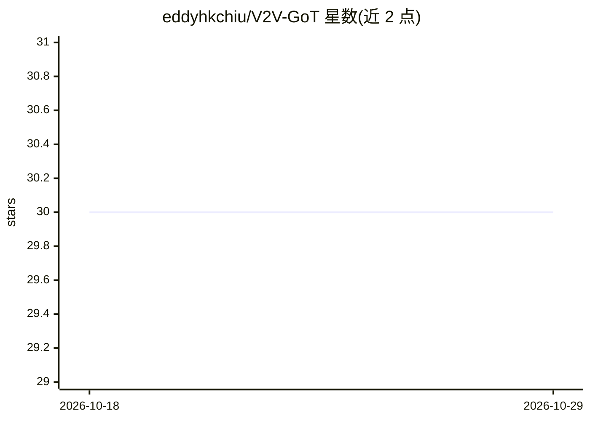

# eddyhkchiu/V2V-GoT

⭐ 30 · Python · 推送 2026-04-01 · [GitHub](https://github.com/eddyhkchiu/V2V-GoT) · [官网](https://arxiv.org/abs/2509.18053) · 组织维护

**车联网协同自动驾驶的 MLLM 图思维推理框架（ICRA2026 论文代码）**

NVIDIA 与 CMU 研究者的论文官方代码：提出首个面向 MLLM 协同自动驾驶的 graph-of-thoughts 推理框架，含遮挡感知感知与规划感知预测设计；各 CAV 向 MLLM 共享感知特征，模型融合后按图结构逐节点问答生成轨迹建议或回答感知/预测问题。配套发布 V2V-GoT-QA 数据集、V2V4Real 检测结果与特征、可复现论文指标的两套模型 checkpoint（V2V-GoT 与基线 V2V-LLM），基于 LLaVA 1.5 微调。使用需分别按 DMSTrack 与 LLaVA 1.5 指引搭建两个 conda 环境，提供推理、评测、可视化与训练脚本。

## 筛选速览

| 维度 | 判定 | 备注 |
|---|---|---|
| AI 角色 | `ai-native` | 本体是模型或模型工具 |
| 许可风险 | `none` | — |
| 部署形态 | `None` |  |
| 模型依赖 | — | README 未给出锁定关系 |
| 硬件要求 | — | 无带数字的原话,不猜 |
| 安装摩擦 | `low` | 无编译、无系统依赖或容器化 |
| 成熟度 | — | 结构信号不足 |

## 能力要点

- 面向 MLLM 协同驾驶的 graph-of-thoughts 推理框架（QA 节点按有向边传递上下文）
- 发布 V2V-GoT-QA 数据集与 V2V4Real 处理后特征、点云、真值数据
- 提供 V2V-GoT 与 V2V-LLM 两套可复现论文指标的 checkpoint，从 LLaVA 1.5 LoRA 微调
- 覆盖推理、评测、可视化、训练全流程脚本

## 适用场景

- 复现论文中协同感知、预测与规划任务的实验结果
- 在 V2V4Real 数据上训练或微调协同驾驶 MLLM
- 研究 graph-of-thoughts 推理在多智能体驾驶决策中的应用

## 场景标签

`多模态` `微调` `目标检测` · 领域:感知与多模态

## 证据(README 行号)

> L9:  V2V-GoT : Graph-of-thoughts reasoning framework for vehicle-to-vehicle cooperative autonomous driving. All Connecte
> L12: We propose the first graph-of-thoughts framework specifically designed for MLLM-based cooperative autonomous drivin

## 星数曲线

2026-10-18 30 → 2026-10-29 30（+0）

---
*卡片 v1 · prompt 1.4 · 生成 2026-10-26 · 置信度 high · 依据 README sha `c7bdd0951290` · [字段定义](../../DATASET.md)*
