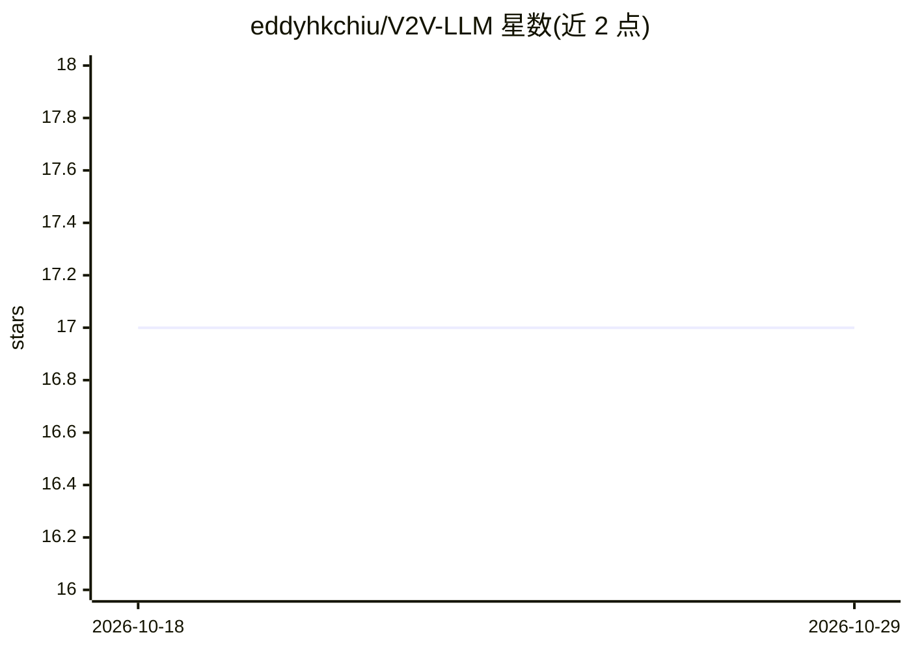

# eddyhkchiu/V2V-LLM

⭐ 17 · 推送 2026-03-03 · [GitHub](https://github.com/eddyhkchiu/V2V-LLM) · [官网](https://arxiv.org/abs/2502.09980) · 组织维护

**面向车联网协同驾驶的多模态大语言模型基线与问答数据集**

ICRA2026 论文官方代码：提出将 LLM 融入多车协同自动驾驶的问题设定，发布 V2V-QA 数据集与基准，并给出 V2V-LLM 基线模型——用 LLM 融合多辆网联自动驾驶车辆的感知信息，回答定位、显著目标识别与规划等驾驶相关问题。面向自动驾驶与机器人方向的研究人员。注意：README 声明代码与数据集已并入后续工作 V2V-GoT，请使用该仓库。

## 筛选速览

| 维度 | 判定 | 备注 |
|---|---|---|
| AI 角色 | `ai-native` | 本体是模型或模型工具 |
| 许可风险 | `none` | — |
| 部署形态 | `None` |  |
| 模型依赖 | — | README 未给出锁定关系 |
| 硬件要求 | — | 无带数字的原话,不猜 |
| 安装摩擦 | `low` | 无编译、无系统依赖或容器化 |
| 成熟度 | — | 结构信号不足 |

## 能力要点

- 提出 LLM 融入协同自动驾驶的问题设定
- V2V-QA 数据集与基准
- V2V-LLM 基线：LLM 融合多车感知信息回答驾驶问题（grounding/目标识别/规划）

## 适用场景

- 开展车联网协同自动驾驶研究
- 在 V2V-QA 基准上评测多模态大模型
- 复现论文基线方法

## 场景标签

`多模态` `模型评测` · 领域:评测与运维

## 证据(README 行号)

> L16: We propose a novel problem setting that integrates an LLM into cooperative autonomous driving, with the proposed Ve
> L6: # V2V-LLM: Vehicle-to-Vehicle Cooperative Autonomous Driving with Multimodal Large Language Models

## 星数曲线

2026-10-18 17 → 2026-10-29 17（+0）

---
*卡片 v1 · prompt 1.4 · 生成 2026-10-29 · 置信度 high · 依据 README sha `f766a8b617e4` · [字段定义](../../DATASET.md)*
