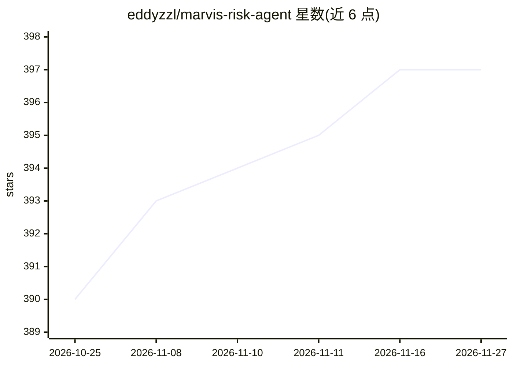

# eddyzzl/marvis-risk-agent

⭐ 397 · Python · MIT · 推送 2026-11-10 · [GitHub](https://github.com/eddyzzl/marvis-risk-agent) · 个人维护 · 中文 README

**本地信贷风控 Agent 工作台：从业务问题到模型与策略报告**

MARVIS 是一个本地优先的信贷风控 Agent 桌面平台：用户用自然语言描述风险目标，Agent 澄清缺失材料、生成可审查的工作流计划，在责任确认门暂停，运行确定性工具并产出数据集、证据、模型、策略代码与报告。功能覆盖数据处理、特征分析、模型开发与校验、策略开发、Vintage 分析、组合与监控七大模块。支持中英界面、任务工作区、记忆复用与审计记录；关键指标由平台代码计算，后果性操作需人工确认，材料默认保留在本地。

## 筛选速览

| 维度 | 判定 | 备注 |
|---|---|---|
| AI 角色 | `ai-native` | 本体是模型或模型工具 |
| 许可风险 | `permissive` | MIT |
| 部署形态 | `desktop` | 安装包/桌面程序 |
| 模型依赖 | — | README 未给出锁定关系 |
| 硬件要求 | — | 无带数字的原话,不猜 |
| 安装摩擦 | `low` | 无编译、无系统依赖或容器化 |
| 成熟度 | `idea` | |

## 能力要点

- 自然语言描述业务目标，Agent 生成可审查工作流计划并在责任门暂停确认
- 七大模块：数据处理、特征分析、模型开发/校验、策略开发、Vintage、组合分析
- 确定性工具计算关键指标，保留证据、哈希与审计溯源
- 中英双语界面，支持 Workflow 模板、插件、Hook 与用户自定义 Skill

## 适用场景

- 客户分群恶化或欺诈信号出现时，快速完成数据分析到策略调整的闭环
- 信采风控团队开发、校验评分模型并产出审计可查的 Excel/Word 报告
- 将机构风控经验封装为可复用的 Workflow 模板与有来源引用的记忆
- 对提交的 PMML/Notebook 模型做批量校验与监控交接

## 场景标签

`数据分析` `工作流自动化` · 领域:效率与自动化

## 证据(README 行号)

> L23: MARVIS is a local-first, governed credit-risk Agent platform—not a chatbot
> L71: MARVIS brings those needs into one governed workspace. The aim is to put AI
> L126: |**Data processing**|Register CSV/Excel files, infer schemas, profile data, align columns, propose and confirm joi

## 星数曲线

2026-10-25 390 → 2026-11-27 397（+7）

---
*卡片 v1 · prompt 1.4 · 生成 2026-11-25 · 置信度 high · 依据 README sha `389f424477cc` · [字段定义](../../DATASET.md)*
