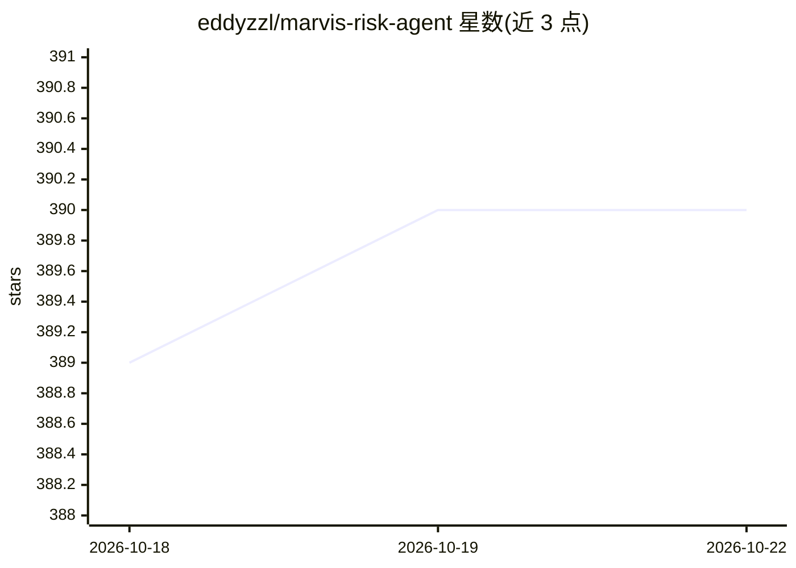

# eddyzzl/marvis-risk-agent

⭐ 390 · Python · MIT · 推送 2026-10-15 · [GitHub](https://github.com/eddyzzl/marvis-risk-agent) · 个人维护 · 中文 README

**面向风险团队：本地信贷风控Agent，从数据到策略与报告**

面向信贷风控团队的本地优先Agent平台：自然语言描述需求后，Agent澄清输入、生成可审查计划、在责任关卡暂停，调用确定性工具完成数据处理、特征工程、建模、验证与七步策略开发，输出数据集、模型、PMML、策略代码与报告。AI负责理解规划，指标由确定性代码计算并附带溯源证据；组合分析模块公开部分未达生产级。

## 筛选速览

| 维度 | 判定 | 备注 |
|---|---|---|
| AI 角色 | `ai-native` | 本体是模型或模型工具 |
| 许可风险 | `permissive` | MIT |
| 部署形态 | `desktop` | 安装包/桌面程序 |
| 模型依赖 | — | README 未给出锁定关系 |
| 硬件要求 | — | 无带数字的原话,不猜 |
| 安装摩擦 | `low` | 无编译、无系统依赖或容器化 |
| 成熟度 | `idea` | |

## 能力要点

- 七步策略开发工作流：从样本设计到影响测量与审查包交付
- KS/AUC/PSI等指标由确定性平台代码计算并附带溯源与审计证据
- 数据到建模工作流：支持PMML导出并直接移交模型验证
- 高影响操作在责任关卡暂停，需人工确认

## 适用场景

- 用自然语言驱动信贷风控的建模与验证全流程
- 开发审批/限额/定价策略并生成可审计的审查包
- 对Vintage与组合进行风险分析并输出Excel报告

## 场景标签

`金融量化` `数据分析` · 领域:效率与自动化

## 证据(README 行号)

> L23: MARVIS is a local-first, governed credit-risk Agent platform—not a chatbot
> L26: Describe the business outcome in natural language. MARVIS asks for missing

## 星数曲线

2026-10-18 389 → 2026-10-22 390（+1）

---
*卡片 v1 · prompt 1.4 · 生成 2026-10-21 · 置信度 high · 依据 README sha `851c22affcc7` · [字段定义](../../DATASET.md)*
