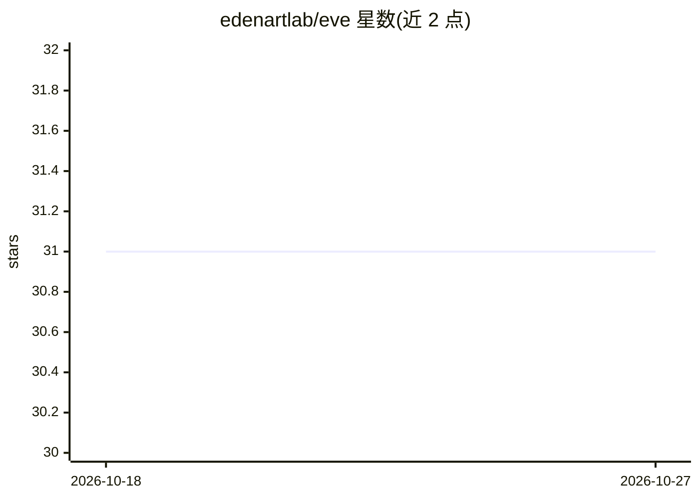

# edenartlab/eve

⭐ 31 · Python · 推送 2026-09-20 · [GitHub](https://github.com/edenartlab/eve) · [官网](https://www.eden.art/) · 组织维护

**Eden 自主数字艺术家 agent 平台的核心代码库**

Eden.art 的核心仓库，为构建自主数字艺术家提供基础：agent 通过自然语言对话理解、生成与迭代视觉内容，底层组合 ComfyUI、Stable Diffusion 等开源 AI 工具。仓库包含 Agent Deploy Wiki、基于 Docker Compose 的本地 FalkorDB 启动方式、以及工具定价体系——工具价格仅存于其 api.yaml 的 cost_estimate 字段，CI 通过 make price-check 与 eve tool price-sync 保持仓库与生产数据库一致。当前处于活跃开发中，README 提示频繁变更。

## 筛选速览

| 维度 | 判定 | 备注 |
|---|---|---|
| AI 角色 | `ai-ecosystem` | LLM/agent 周边工具 |
| 许可风险 | `none` | — |
| 部署形态 | `self-host` | docker 或自建部署 |
| 模型依赖 | — | README 未给出锁定关系 |
| 硬件要求 | — | 无带数字的原话,不猜 |
| 安装摩擦 | `low` | 无编译、无系统依赖或容器化 |
| 成熟度 | `idea` | |

## 能力要点

- 构建可通过自然语言对话创作视觉内容的自主 agent
- 与 ComfyUI 节点套件与工作流仓库配套的工具生态
- 工具定价集中在 api.yaml 的 cost_estimate 字段，CI 校验仓库与生产库一致
- 本地 FalkorDB 通过 docker compose 启动（默认端口 6380，含 Web UI）

## 适用场景

- 基于开源 AI 工具构建自主数字艺术家
- 向 Eden 生态贡献 ComfyUI 工作流供 agent 使用
- 管理与同步 agent 工具的调用定价

## 场景标签

`图像生成` `Agent 框架` · 领域:Agent 开发

## 证据(README 行号)

> L12: Welcome to Eve, the core repository powering Eden.art's creative AI assistants. This codebase enables the developme
> L18: Our mission is to democratize the creation of powerful creative AI agents. Eve makes it possible for anyone to buil

## 星数曲线

2026-10-18 31 → 2026-10-27 31（+0）

---
*卡片 v1 · prompt 1.4 · 生成 2026-10-26 · 置信度 low · 依据 README sha `2813b1d6a45d` · [字段定义](../../DATASET.md)*
