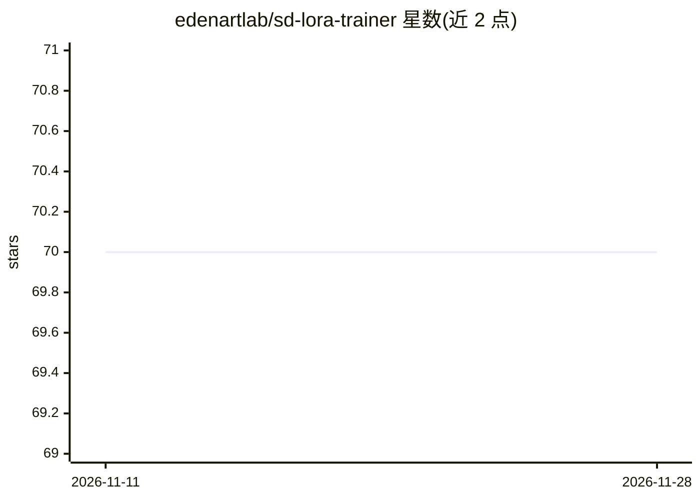

# edenartlab/sd-lora-trainer

⭐ 70 · Python · NOASSERTION · 推送 2026-11-11 · [GitHub](https://github.com/edenartlab/sd-lora-trainer) · [官网](https://www.eden.art/) · 组织维护

**面向 SD15/SDXL 的 LoRa 与全量微调训练器**

Eden 团队开发的 Stable Diffusion 训练器：单个训练脚本与 loss 模块同时支持 SDv15 与 SDXL 的 LoRa 训练和完整 unet 微调，提供 style/face/object 三种默认训练模式，可选接入 OpenAI API 清洗自动生成的提示词并注入可训练 token。产出与 ComfyUI 和 AUTO1111 兼容，可通过托管服务、Replicate、ComfyUI 节点或独立 Python 脚本四种方式运行。已知限制：SD15 的纯 textual inversion 效果不佳，ComfyUI 节点方式训练速度约为 Python 直跑的三分之一。

## 筛选速览

| 维度 | 判定 | 备注 |
|---|---|---|
| AI 角色 | `ai-ecosystem` | LLM/agent 周边工具 |
| 许可风险 | `none` | NOASSERTION |
| 部署形态 | `library` | 以包/库形式分发 |
| 模型依赖 | — | README 未给出锁定关系 |
| 硬件要求 | — | 无带数字的原话,不猜 |
| 安装摩擦 | `low` | 无编译、无系统依赖或容器化 |
| 成熟度 | — | 结构信号不足 |

## 能力要点

- 单脚本同时支持 SDv15 与 SDXL 的 LoRa 训练及完整 unet 微调
- 提供 style/face/object 三种默认训练模式
- 输出兼容 ComfyUI 与 AUTO1111，附示例工作流
- 可选通过 OpenAI API 清洗提示词并注入可训练 token

## 适用场景

- 用自己的图片集训练特定风格、人脸或物体的 LoRa
- 对 SDv15/SDXL 模型做完整 unet 微调
- 在 ComfyUI 工作流中直接调用训练节点

## 场景标签

`微调` · 领域:训练与推理

## 证据(README 行号)

> L4: It's a highly optimized trainer that can be used for both full finetuning and training LoRa modules on top of Stable
> L5: It uses a single training script and loss module that works for both **SDv15** and **SDXL**!

## 星数曲线

2026-11-11 70 → 2026-11-28 70（+0）

---
*卡片 v1 · prompt 1.4 · 生成 2026-11-18 · 置信度 mid · 依据 README sha `79b48b88e843` · [字段定义](../../DATASET.md)*
