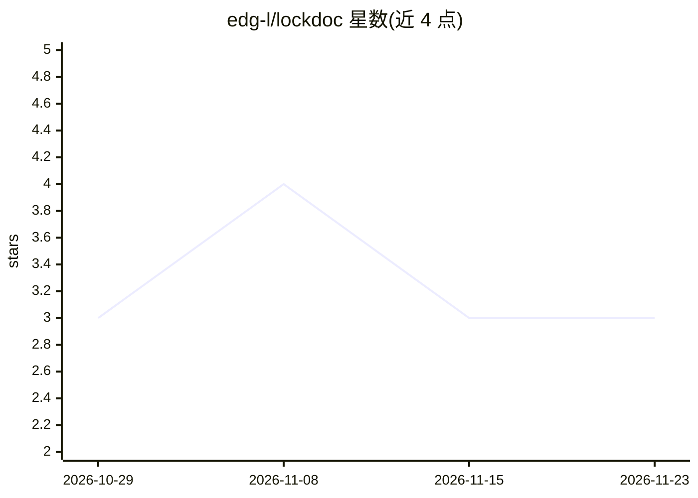

# edg-l/lockdoc

⭐ 3 · Rust · Apache-2.0 · 推送 2026-10-26 · [GitHub](https://github.com/edg-l/lockdoc) · [官网](https://crates.io/crates/lockdoc) · 个人维护

**为 Rust 编码 agent 提供与 Cargo.lock 版本一致的依赖 API 文档的 MCP server**

一个 MCP server：为 Rust 项目的各依赖按 lockfile 解析出的确切版本与 feature 构建 rustdoc JSON，向 coding agent 提供 item 查询、search 搜索与 deps 列表三类工具，路径解析支持 re-export 与 glob。需要 nightly 工具链（版本被固定以匹配解析器）；构建结果写入独立缓存目录、cargo 命令带 --locked，不改动项目。首次查询需构建文档（大依赖可达百秒级），之后走磁盘缓存，毫秒级响应。支持 CLI 直接查询与作为 MCP server 被注册。

## 筛选速览

| 维度 | 判定 | 备注 |
|---|---|---|
| AI 角色 | `ai-ecosystem` | LLM/agent 周边工具 |
| 许可风险 | `permissive` | Apache-2.0 |
| 部署形态 | `library` | 以包/库形式分发 |
| 模型依赖 | — | README 未给出锁定关系 |
| 硬件要求 | — | 无带数字的原话,不猜 |
| 安装摩擦 | `low` | 无编译、无系统依赖或容器化 |
| 成熟度 | — | 结构信号不足 |

## 能力要点

- 按 Cargo.lock 的确切版本与 feature 构建 rustdoc JSON 并回答查询
- 提供 item/search/deps 三个 MCP 工具，另有等价的 shell 命令
- 独立 target 目录与 --locked 运行，不干扰项目构建与锁文件
- 磁盘缓存复用，二次查询毫秒级

## 适用场景

- 让 coding agent 查询项目锁定版本的依赖 API 而非训练数据中的旧版本
- 在 shell 中核对 agent 能看到的依赖签名
- 排查依赖版本不匹配导致的编译报错

## 场景标签

`编码 Agent` · 领域:编码与开发

## 证据(README 行号)

> L7: An MCP server for coding agents working in Rust.
> L15: lockdoc gives the agent the real signatures instead. It builds rustdoc JSON for each
> L16: dependency at the exact version and feature set your lockfile resolves, and answers lookups

## 星数曲线

2026-10-29 3 → 2026-11-23 3（+0）

---
*卡片 v1 · prompt 1.4 · 生成 2026-11-22 · 置信度 high · 依据 README sha `fef5186aca7c` · [字段定义](../../DATASET.md)*
